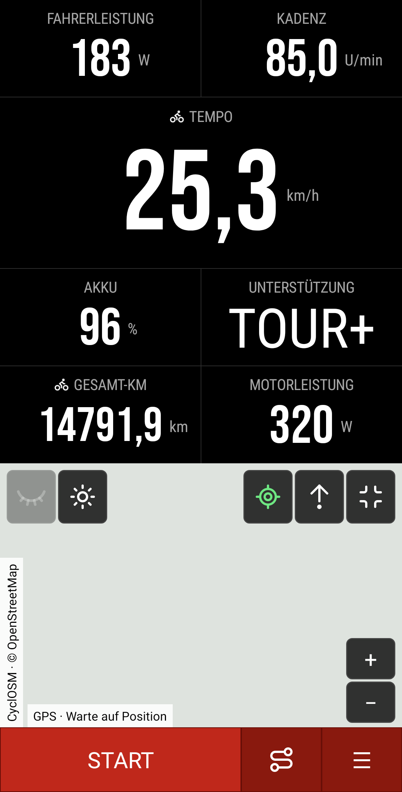
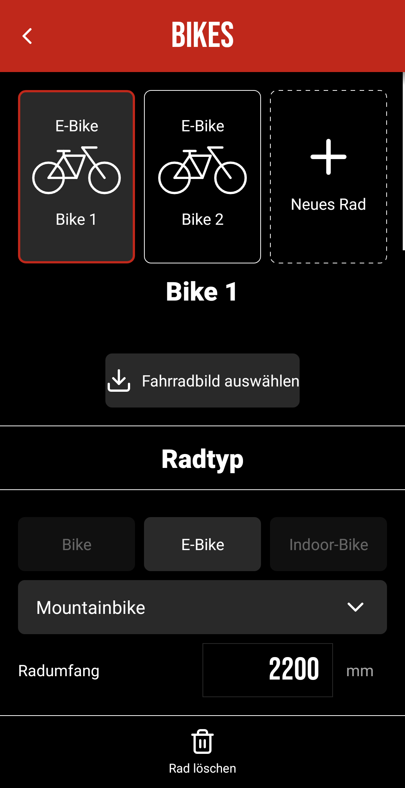
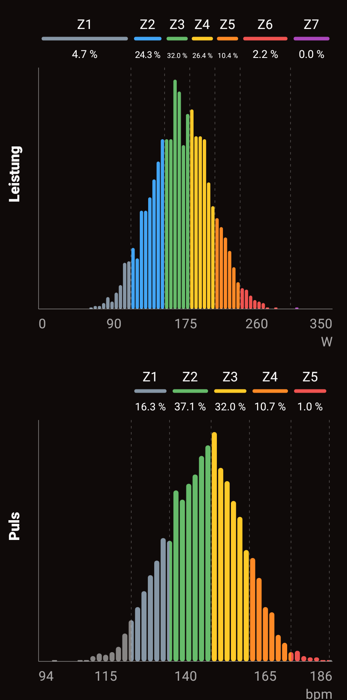
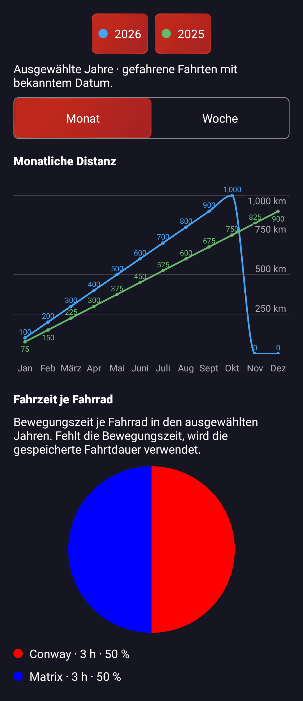
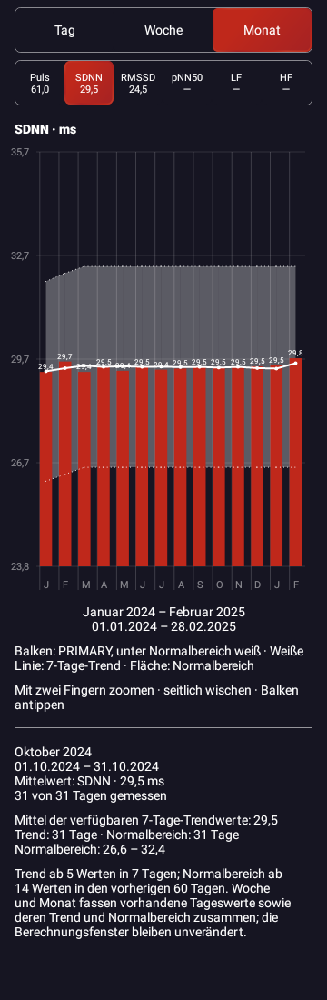
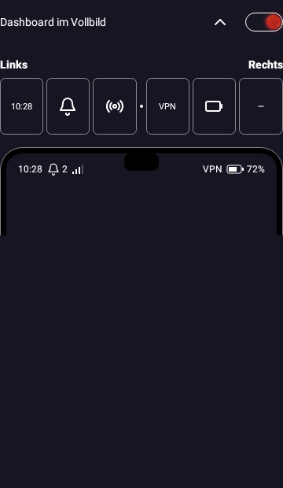

<p align="center">
  
</p>

<h1 align="center">B|CYCLE</h1>

<p align="center">
  Dein Fahrradcomputer für Android – Live-Daten, Karten und Trainingsanalyse.
</p>

<p align="center">
  <a href="#apk-herunterladen">APK herunterladen</a> ·
  <a href="#key-features">Key Features</a> ·
  <a href="#erste-schritte">Erste Schritte</a> ·
  <a href="#dokumentation-und-lizenzen">Dokumentation</a>
</p>

<table>
  <tr>
    <td width="33%" align="center"><a href="docs/assets/showcase-dashboard.png"></a></td>
    <td width="33%" align="center"><a href="docs/previews/bikes-sections.png"></a></td>
    <td width="33%" align="center"><a href="docs/previews/track-distributions.png"></a></td>
  </tr>
  <tr>
    <td align="center"><strong>Dein Dashboard</strong></td>
    <td align="center"><strong>Deine Bikes</strong></td>
    <td align="center"><strong>Deine Auswertung</strong></td>
  </tr>
</table>

Neu in 0.8.56: Jahresvergleiche, HRV-Zeiträume und eine frei belegbare Dashboard-Statuszeile.

<table>
  <tr>
    <td width="33%" align="center" valign="top"><strong>Statistik · Monatsvergleich</strong><br><a href="docs/previews/statistics.png"></a></td>
    <td width="33%" align="center" valign="top"><strong>HRV · Monatsmittel</strong><br><a href="docs/previews/hrv-period-month-glow.png"></a></td>
    <td width="33%" align="center" valign="top"><strong>Statuszeile · Deine Belegung</strong><br><a href="docs/previews/dashboard-status-settings-glow.png"></a></td>
  </tr>
</table>

[Wochenansicht mit Zoom ansehen](docs/previews/statistics-week.png) · [HRV im Flat-Design](docs/previews/hrv-period-month-flat.png) · [Statuszeile im Flat-Design](docs/previews/dashboard-status-settings-flat.png)

Die Vorschauen zeigen native App-Ansichten mit synthetischen Testdaten. Die langen Ansichten enthalten auch Inhalte unterhalb des sichtbaren Scrollbereichs. Kartenkacheln sind in der Dashboard-Vorschau nicht geladen; in der Statusvorschau ersetzt eine Glocke das in der Testumgebung nicht installierte Messengericon.

[UI-Atlas als HTML herunterladen](https://raw.githubusercontent.com/Titanyus/B-Cycle/main/docs/previews/ui-catalog.html) · Datei lokal im Browser öffnen. Offline-Übersicht mit 21 Bauteilgruppen, Theme-/Breiten-/Schriftvergleich, Abstandshilfen und Quelleninspektor. [Anleitung und Prüfstand](docs/ui-catalog.md).

League Gothic ersetzt im aktuellen Quellstand die bisherige Bebas Neue; Schriftrollen zentral, Großschreibung nur für Fenstertitel erzwungen. In APK 0.8.24 enthalten.

In APK 0.8.24: Dashboard mit Strecken links und Start/Stop mittig; HRV manuell über die Einstellungen oder optional beim ersten Tagesstart. Neue Abschluss-Signale und kompakteres Tagesbefinden. [Umfang und Prüfung](docs/hrv-entry.md). Schriftwechsel und finale Sliderabstände sind ebenfalls enthalten.

In APK 0.8.25: HRV4Training-CSV-Import unter „Daten & Speicher → HRV-Pulsdaten“, mit Vorschau, Datumsprüfung und Dublettenschutz. Originale Tagesangaben bleiben erhalten; RR-Rohdaten sind im CSV nicht enthalten. [Umfang und Grenzen](docs/hrv4training-import.md). Zusätzlich gilt nur die letzte HRV-Messung pro lokalem Tag; ältere bleiben vollständig archiviert. [Tagesregel](docs/hrv-daily-selection.md).

In APK 0.8.26: neuer Bildschirm **HRV-Auswertung** über die HRV-Einstellungen und „Zur Auswertung“ nach dem Tagesbefinden. Tagesbalken, 7-Tage-Mittel, eigener dokumentierter Normalbereich und Zweifinger-Zoom. Dazu die Korrektur der hängenbleibenden CSV-Prüfanzeige. [Umfang und Berechnung](docs/hrv-trends.md).

In APK 0.8.27: Tagesbefinden mit elf Stufen 0–10, gerundete HRV4-Sliderantworten und sichere Ergänzung fehlender Antworten vorhandener Importe beim Öffnen. Alte Neunerskala wird mit erhaltenen Originalwerten übertragen. HRV-Korridor weiß mit 40 % Deckkraft und gepunkteten 1-dp-Grenzen.

In APK 0.8.29: kombinierte Aufsteh-/Schlafenszeit, optionale Schlafdauer und global halbierter Auswahlpunkt-/Textabstand. HRV-Diagramm mit fester Y-Skala je Kennzahl, 40 % mehr Höhe und besser genutztem linken Rand. ACCENT-Balken, weiße Werte unter Normalbereich, weiße 7-Tage-Linie und Korridor mit 30 % Deckkraft. Gemeinsame Referenzhistorie aus B-Cycle und HRV4Training, ohne künstlichen Neustart nach Quellenwechsel.

## Key Features

- **Individuelle Dashboards** – Bis zu sechs benannte Seiten, 13 Layout-Vorlagen und frei belegbare Datenfelder mit großen, gut ablesbaren Zahlen.
- **Live-Daten vom Rad** – Bosch-E-Bike, BLE-/FTMS-Indoor-Trainer, GPS und BLE-Pulsmesser; Fahrerleistung und Motorleistung bleiben getrennt.
- **Karten unterwegs** – Online- und Offline-Karten, Tages-/Nachtansicht, GPX-Strecken und Höhenanzeige an der aktuellen Position.
- **FIT-Aufzeichnung** – Gewünschte Messwerte und Hauptquellen selbst auswählen; Aufzeichnung auch bei ausgeschaltetem Bildschirm.
- **Fahrten im Detail** – Karte, fünf Verlaufsdiagramme, Bewegungszeit, Höhenmeter und Performance-Kennzahlen wie Normalized Power und Estimated FTP bei geeigneten Daten.
- **Trainingszonen** – Persönliche Leistungs- und Pulszonen, Zonenanteile, Verteilungshistogramme und bis zu vier Best Efforts mit Watt und W/kg.
- **Live-Graphen und Ambient-Glow** – Daten und Hintergrundgraphen je Kachel kombinieren, Trainingshilfe je Dashboard wählen; Fahrmodus und Akkuwarnung am Bildschirmrand erkennen.
- **Fahrradprofile** – Bis zu sechs Räder mit eigenen Namen, Fotos, Radkategorie, Radumfang, Sensorzuordnungen, FIT-Einstellungen sowie eigenen Themes, Dashboards und Kartenoptionen. E-Bike und Indoor sind nutzbar; normales Bike ist vorbereitet.
- **Dein Design** – 14 vorgegebene Farbthemen mit einheitlicher Bedienung, sofort gespeicherten Einstellungen und Hochformat-Layouts.
- **Export und Upload** – Lokal speichern oder eigene Fahrten an WebDAV, intervals.icu, Dreeve und Strava senden. Dienste arbeiten unabhängig; Dreeve benötigt eine eigene Instanz, Strava derzeit eine persönliche API-App.
- **HRV-Ruhemessung** – RR-fähigen Pulsmesser verwenden, Protokollzeiten einstellen und Ergebnisse mit Zeit-/Frequenzwerten sowie Rohdaten dauerhaft speichern und gezielt exportieren.
- **Wetter und Höhe** – Wetter zur Tourmitte dauerhaft speichern und bei Bedarf GPS-Höhen nachträglich mit Mapterhorn korrigieren; Original-FIT bleibt erhalten.
- **Schlanke Android-App** – Native Kotlin-Views, Android 13+, rund 2,4 MB optimierte APK. Keine automatische Telemetrie.

## APK herunterladen

[](https://github.com/Titanyus/B-Cycle/actions/workflows/android-debug.yml)

**[Version 0.8.66 · Build 107 – APK direkt herunterladen](https://raw.githubusercontent.com/Titanyus/B-Cycle/main/downloads/B-Cycle-0.8.66-release-107.apk)**

**Build 107 vom 30.10.2026 · 2,54 MB · Android 13+.** Direkter APK-Download ohne ZIP.
Optimierter Release mit R8 und Ressourcenverkleinerung, ohne Debug- oder Test-Flag.
APK-Prüfsumme, Ausrichtung und dauerhafte Signatur wurden geprüft.
**Als Update über gleich signierte Versionen seit Build 53 installierbar.** Ältere, anders signierte Installationen
(einschließlich Build 52 und der alten Testschlüssel) lassen sich damit nicht direkt
aktualisieren. Bestehende Appdaten vor einem Installationswechsel sichern.

[Änderungen in 0.8.66](docs/release-0.8.66.md) ·
[Buildnachweis und SHA-256](docs/build-107.md) ·
[Erfolgreicher Actions-Build](https://github.com/Titanyus/B-Cycle/actions/runs/41027627537) ·
[Build-Anleitung und Signierung](docs/github-actions.md).
Gezielte Regressionstests lassen sich separat unter Actions → **Targeted regression tests** → **Run workflow** starten, lokal mit `bash scripts/test-regressions.sh`. Dabei werden nur Testberichte erzeugt; kein APK-Build und kein Signierschlüsselzugriff. [Umfang und Nachweise](docs/priority-optimizations.md).
Gezielte Chromatic-/Designerreferenz-, Formular-, Flat-/Glow-, Karten-/Zoom-, Feldauswahl-, Dienst-/HTTP-, Upload-/Namens- und Sicherungsprüfungen während der Umsetzung erfolgreich; native Vorschauen sowie Typografie-/Atlas-/Designerprüfung erfolgreich.
HRV-Messwerte und Aufzeichnungen erhalten; Antworten getrennt gespeichert und mitgesichert.
Kein vollständiger Gesamttestlauf; frühere Prüfungen und bekannte ältere UI-Testfehler in den Buildnachweisen.

Frühere APKs: [0.8.65 · Build 106](https://raw.githubusercontent.com/Titanyus/B-Cycle/main/downloads/B-Cycle-0.8.65-release-106.apk) · [0.8.64 · Build 105](https://raw.githubusercontent.com/Titanyus/B-Cycle/main/downloads/B-Cycle-0.8.64-release-105.apk) · [0.8.63 · Build 104](https://raw.githubusercontent.com/Titanyus/B-Cycle/main/downloads/B-Cycle-0.8.63-release-104.apk) · [0.8.62 · Build 103](https://raw.githubusercontent.com/Titanyus/B-Cycle/main/downloads/B-Cycle-0.8.62-release-103.apk) · [0.8.61 · Build 102](https://raw.githubusercontent.com/Titanyus/B-Cycle/main/downloads/B-Cycle-0.8.61-release-102.apk) · [0.8.60 · Build 101](https://raw.githubusercontent.com/Titanyus/B-Cycle/main/downloads/B-Cycle-0.8.60-release-101.apk) · [0.8.59 · Build 100](https://raw.githubusercontent.com/Titanyus/B-Cycle/main/downloads/B-Cycle-0.8.59-release-100.apk) · [0.8.58 · Build 99](https://raw.githubusercontent.com/Titanyus/B-Cycle/main/downloads/B-Cycle-0.8.58-release-99.apk) · [0.8.57 · Build 98](https://raw.githubusercontent.com/Titanyus/B-Cycle/main/downloads/B-Cycle-0.8.57-release-98.apk) · [0.8.56 · Build 97](https://raw.githubusercontent.com/Titanyus/B-Cycle/main/downloads/B-Cycle-0.8.56-release-97.apk) · [0.8.55 · Build 96](https://raw.githubusercontent.com/Titanyus/B-Cycle/main/downloads/B-Cycle-0.8.55-release-96.apk) · [0.8.54 · Build 95](https://raw.githubusercontent.com/Titanyus/B-Cycle/main/downloads/B-Cycle-0.8.54-release-95.apk) · [0.8.53 · Build 93](https://raw.githubusercontent.com/Titanyus/B-Cycle/main/downloads/B-Cycle-0.8.53-release-93.apk) · [0.8.52 · Build 92](https://raw.githubusercontent.com/Titanyus/B-Cycle/main/downloads/B-Cycle-0.8.52-release-92.apk) · [0.8.51 · Build 91](https://raw.githubusercontent.com/Titanyus/B-Cycle/main/downloads/B-Cycle-0.8.51-release-91.apk) · [0.8.50 · Build 90](https://raw.githubusercontent.com/Titanyus/B-Cycle/main/downloads/B-Cycle-0.8.50-release-90.apk) · [0.8.49 · Build 89](https://raw.githubusercontent.com/Titanyus/B-Cycle/main/downloads/B-Cycle-0.8.49-release-89.apk) · [0.8.48 · Build 88](https://raw.githubusercontent.com/Titanyus/B-Cycle/main/downloads/B-Cycle-0.8.48-release-88.apk) · [0.8.47 · Build 87](https://raw.githubusercontent.com/Titanyus/B-Cycle/main/downloads/B-Cycle-0.8.47-release-87.apk) · [0.8.46 · Build 86](https://raw.githubusercontent.com/Titanyus/B-Cycle/main/downloads/B-Cycle-0.8.46-release-86.apk) · [0.8.45 · Build 85](https://raw.githubusercontent.com/Titanyus/B-Cycle/main/downloads/B-Cycle-0.8.45-release-85.apk) · [0.8.44 · Build 84](https://raw.githubusercontent.com/Titanyus/B-Cycle/main/downloads/B-Cycle-0.8.44-release-84.apk) · [0.8.43 · Build 83](https://raw.githubusercontent.com/Titanyus/B-Cycle/main/downloads/B-Cycle-0.8.43-release-83.apk) · [0.8.42 · Build 82](https://raw.githubusercontent.com/Titanyus/B-Cycle/main/downloads/B-Cycle-0.8.42-release-82.apk) · [0.8.41 · Build 81](https://raw.githubusercontent.com/Titanyus/B-Cycle/main/downloads/B-Cycle-0.8.41-release-81.apk) · [0.8.40 · Build 80](https://raw.githubusercontent.com/Titanyus/B-Cycle/main/downloads/B-Cycle-0.8.40-release-80.apk) · [0.8.39 · Build 78](https://raw.githubusercontent.com/Titanyus/B-Cycle/main/downloads/B-Cycle-0.8.39-release-78.apk) · [0.8.38 · Build 77](https://raw.githubusercontent.com/Titanyus/B-Cycle/main/downloads/B-Cycle-0.8.38-release-77.apk) · [0.8.37 · Build 76](https://raw.githubusercontent.com/Titanyus/B-Cycle/main/downloads/B-Cycle-0.8.37-release-76.apk) · [0.8.36 · Build 75](https://raw.githubusercontent.com/Titanyus/B-Cycle/main/downloads/B-Cycle-0.8.36-release-75.apk) · [0.8.35 · Build 74](https://raw.githubusercontent.com/Titanyus/B-Cycle/main/downloads/B-Cycle-0.8.35-release-74.apk) · [0.8.34 · Build 73](https://raw.githubusercontent.com/Titanyus/B-Cycle/main/downloads/B-Cycle-0.8.34-release-73.apk) · [0.8.33 · Build 72](https://raw.githubusercontent.com/Titanyus/B-Cycle/main/downloads/B-Cycle-0.8.33-release-72.apk) · [0.8.32 · Build 71](https://raw.githubusercontent.com/Titanyus/B-Cycle/main/downloads/B-Cycle-0.8.32-release-71.apk) · [0.8.31 · Build 70](https://raw.githubusercontent.com/Titanyus/B-Cycle/main/downloads/B-Cycle-0.8.31-release-70.apk) · [0.8.30 · Build 69](https://raw.githubusercontent.com/Titanyus/B-Cycle/main/downloads/B-Cycle-0.8.30-release-69.apk) · [0.8.29 · Build 68](https://raw.githubusercontent.com/Titanyus/B-Cycle/main/downloads/B-Cycle-0.8.29-release-68.apk) · [0.8.27 · Build 66](https://raw.githubusercontent.com/Titanyus/B-Cycle/main/downloads/B-Cycle-0.8.27-release-66.apk) · [0.8.26 · Build 65](https://raw.githubusercontent.com/Titanyus/B-Cycle/main/downloads/B-Cycle-0.8.26-release-65.apk) · [0.8.25 · Build 64](https://raw.githubusercontent.com/Titanyus/B-Cycle/main/downloads/B-Cycle-0.8.25-release-64.apk) · [0.8.24 · Build 63](https://raw.githubusercontent.com/Titanyus/B-Cycle/main/downloads/B-Cycle-0.8.24-release-63.apk) · [0.8.23 · Build 62](https://raw.githubusercontent.com/Titanyus/B-Cycle/main/downloads/B-Cycle-0.8.23-release-62.apk) · [0.8.22 · Build 61](https://raw.githubusercontent.com/Titanyus/B-Cycle/main/downloads/B-Cycle-0.8.22-release-61.apk) · [0.8.21 · Build 60](https://raw.githubusercontent.com/Titanyus/B-Cycle/main/downloads/B-Cycle-0.8.21-release-60.apk) · [0.8.20 · Build 59](https://raw.githubusercontent.com/Titanyus/B-Cycle/main/downloads/B-Cycle-0.8.20-release-59.apk) · [0.8.19 · Build 58](https://raw.githubusercontent.com/Titanyus/B-Cycle/main/downloads/B-Cycle-0.8.19-release-58.apk) · [0.8.18 · Build 57](https://raw.githubusercontent.com/Titanyus/B-Cycle/main/downloads/B-Cycle-0.8.18-release-57.apk).
Weitere Builds unter [GitHub Actions](https://github.com/Titanyus/B-Cycle/actions/workflows/android-debug.yml).
Compile-/Target-SDK 36; feste Signierung für künftige Updates über Actions-Secret.

## Neu in APK 0.8.66

- Drei nummerierte Tracks auf der Karte mit eigenen Stilen, Platzwahl im Streckenmanager und farbigen Augen-Buttons auf dem Dashboard.
- Trackauswahl und Sichtbarkeit je Fahrradprofil, einschließlich Einstellungssicherung.
- Statusleiste: Datenschutzmeldung reserviert nur noch 4 dp zusätzlich rechts.
- [Änderungen und Prüfgrenzen](docs/release-0.8.66.md) · [Drei Kartentracks](docs/three-map-tracks.md).

## Neu in APK 0.8.65

- HRV zu intervals.icu: automatische tägliche Übertragung und Sammelupload fehlender HRV-Tage; vorhandene fremde Werte erhalten.
- Tagesbefinden mit Trainingsvorauswahl aus Vortagsfahrten/Pulszonen und bedingter Belastungsfrage.
- Vollständige Dropdownrahmen, einheitliche Auswahlabstände und transparenter Hintergrund der Dashboard-Fahrradauswahl.
- [Änderungen und Prüfgrenzen](docs/release-0.8.65.md) · [HRV-Zuordnung](docs/intervals-hrv.md).

## Neu in APK 0.8.64

- Bestätigte Standpausen aus NP ausnehmen, während Fahrtaufnahme und Gesamtzeit weiterlaufen.90%-NP-Grenze; fehlende Daten bleiben unbekannt.
- Licht-/Akkuwarnkorrektur, kleinerer Record-Kreis und maximale Schriftgrößen für3er-Kacheln.
- Flat-Zonenfarben ohne additive Aufhellung und kompakteres Einstellungsmenü in League Gothic.
- [Menüvorschau](docs/previews/settings-menu-compact.png) · [Änderungen und Prüfgrenzen](docs/release-0.8.64.md).

## Neu in APK 0.8.63

- Anzeigedauer von Benachrichtigungen in5-Sekunden-Schritten.
- Nachrichten und Trinkerinnerung oben/unten48dp vertikal eingerückt; Seiten und Mitte unverändert.
- [Änderungen und Prüfgrenzen](docs/release-0.8.63.md).

## Neu in APK 0.8.62

- Dashboard-Footer ohne Schatten in Flat und Glow.
- Größerer Record-Kreis mit20dpFreiraum um das20dpSymbol; Footerhöhe bleibt gleich.
- [Vorschau](docs/previews/dashboard-record-flat.png) · [Änderungen und Prüfgrenzen](docs/release-0.8.62.md).

## Neu in APK 0.8.61

- Neuer Aufnahmebutton mit Kreisabschnitt und zentriertem Fahrradnamen; Footer bleibt gleich hoch.
- Flat-Zonenbalken und zusätzliches Dashboard ohne Karte1/1/1/3.
- Trenner vor Uploadangaben in der Fahrtzusammenfassung.
- [Vorschau](docs/previews/dashboard-record-flat.png) · [Änderungen und Prüfgrenzen](docs/release-0.8.61.md).

## Neu in APK 0.8.60

- HRV4Training-Befindenswerte älterer Importe automatisch für Farben und Tagesauswertung ergänzen; kein Neuimport nötig.
- Gewünschte HRV-Kontextsymbole; Tagesbefinden direkt zwischen Standard und Training.
- [Änderungen und Prüfgrenzen](docs/release-0.8.60.md).

## Neu in APK 0.8.59

- Fahrradlicht wahlweise oben/unten; Statusränder links8dp/rechts25dp.
- HRV-Kontextfarben mit sechs Symbolen, Tagesfooter und kompakterer Diagrammansicht.
- Eigene Tagesauswertung mit logarithmischem HRV-Wert, Normalbereich, vier Tagen subjektivem Befinden und Ruhepuls, ohne Trendzeile.
- [Tagesauswertung ansehen](docs/previews/hrv-daily-limit-glow.png) · [Kontextfarben ansehen](docs/previews/hrv-context.png).
- [Änderungen und Prüfgrenzen](docs/release-0.8.59.md).

## Neu in APK 0.8.58

- Statistik-Skalen links über durchgehenden Rasterlinien.
- HRV-Korridor dezenter und eigene feste Y-Skalen für Tag, Woche und Monat.
- Statussymbole weiter innen; gemeldeten Android-Indikatorbereich automatisch aussparen.
- [Änderungen und Prüfgrenzen](docs/release-0.8.58.md).

## Neu in APK 0.8.57

- Kompakte Statusbelegung mit sechs neutralen Symbolkacheln,3×2-Auswahldropdown und Handyvorschau.
- Smartphone-Akku mit Prozentwert in der Statuszeile.
- HRV-Achsenlabels bei Platzmangel kürzer, ohne Wochen oder Monate auszublenden.
- [Änderungen und Prüfgrenzen](docs/release-0.8.57.md).

## Neu in APK 0.8.56

- HRV Tag/Woche/Monat mit Tagesgrundlage, kurzen Kalenderlabels und durchgehenden Trennern.
- Eigene konfigurierbare Dashboard-Statuszeile mit Uhrzeit, Messenger-Zähler, VPN, Akku und Mobilfunk.
- Gemeinsames Monats-/Wochendiagramm mit Jahresfarben, Wochenzoom und Jahresfilter für Fahrradzeiten.
- Dashboardauswahl neu sortiert; Abstände und Kartenüberschrift zentral korrigiert.
- [Änderungen und Prüfgrenzen](docs/release-0.8.56.md).

## Neu in APK 0.8.55

- Drei zusätzliche Dashboards ohne Karte und abgestimmte dynamische Schriftgrößen sichtbarer Zweier-/Dreierkacheln.
- Akku-Auswahlschalter korrigiert; Kartenlayer bei Dashboards ohne Karte pausiert, GPS-Aufzeichnung läuft weiter.
- Neue Statistikseite mit Monats-/Wochenkilometern und Fahrzeit je Fahrrad.
- HRV-Mondphasen und datierte, schlichte Header; eigene FIT-Dateien per langem Druck auf Upload neu erzeugen.
- [Alle Änderungen und Prüfgrenzen](docs/release-0.8.55.md).

## Neu in APK 0.8.54

- Leistungs- und Pulsverteilungen als feine Balkendiagramme in den persönlichen Zonenfarben.
- Gemeinsame Trendberechnung aus den gewählten FIT-Quellen; Platzierung bleibt frei wählbar.
- Einheitliche Dropdown-Rahmen bei Backup, Cloud und Wartung; Kartenhöhe separat schaltbar.
- Streckenfilter „Auf Karte angezeigt“ und gröbere Filter-Slider mit 5 km / 5 km/h / 5 min.
- [Änderungen und Prüfgrenzen](docs/release-0.8.54.md).

## Neu in APK 0.8.53

- Einstellungen, Strecken und HRV getrennt lokal oder über WebDAV sichern und wiederherstellen.
- Kompakter Cloud-Bereich und Passwortaugen innerhalb der Eingabefelder.
- Wartung mit Dropdown-Rahmen und kompakten Aktionszeilen.
- Robustere FIT-/GPX-Importauswertung, korrigierter Strecken-Fast-Scroller und Dreeve-Importfortschritt.
- [Änderungen und Prüfgrenzen](docs/release-0.8.53.md).

## Neu in APK 0.8.52

- Schaltwerk-Akku als Dashboardfeld und in der Akku-Mehrfachauswahl.
- Letzter erfolgreich gelesener Stand bleibt nach Trennung und App-Neustart sichtbar.
- Einstellbare zehnsekündige Warnung beim Aufzeichnungsstart unter20%.
- Kompakte SRAM-Sensoranzeige und neue Schaltwerk-/App-Icons.
- [Änderungen und Prüfgrenzen](docs/release-0.8.52.md).

## Neu in APK 0.8.51

- intervals.icu: alle geeigneten Fahrten einschließlich bestätigter Dreeve-Importe gesammelt hochladen, vorhandene Aktivitäten vorher prüfen.
- Dreeve-Verknüpfungsstatus korrigiert und Importliste kompakter mit FIT-/GPX-Kennzeichen über dem Schalter.
- SRAM-Suche berücksichtigt späte Scanantworten und erkannte Kandidaten trotz Geräteprüfungs-Timeout.
- HRV-Auswertung zoomt auch bei eng zusammenliegenden Fingern kontinuierlich weiter.
- [Änderungen und Prüfgrenzen](docs/release-0.8.51.md).

## Neu in APK 0.8.50

- SRAM AXS als Schaltgruppe beim E-Bike: mehrere Komponenten zuordnen, Akku kurz abfragen und letzten Stand mit Zeitstempel anzeigen.
- Separates Bluetooth-Powermeter mit unabhängiger Leistungs-/Kadenzquelle und automatischem Ersatz.
- Dreeve-Import bevorzugt unveränderte FIT-Originale, sonst GPX; bestehende Fahrten und Verknüpfungen bleiben erhalten.
- Wartung nach Fahrrädern und Bauteilen gruppiert, mit automatischer Aktualisierung und offline verfügbarem letzten Stand.
- Hardwareunterstützung insbesondere von Apex/Controllern/Blips noch praktisch prüfen; Gangdaten und virtuelle Schaltung noch nicht enthalten.
- [Änderungen und Prüfgrenzen](docs/release-0.8.50.md).

## Neu in APK 0.8.49

- Rollentrainer-Profil aktiviert, mit gespeicherter Auswahl und Sicherung. Gemeinsame Messwertanbindung für Fahrrad und Zwift-Ride-Rahmen.
- Distanz aus dem Trainerzähler oder ersatzweise beobachteter Geschwindigkeit, ohne Hochrechnung bei Datenlücken.
- Sensorliste zeigt per kleinem Chevron die tatsächlich empfangenen Messwertarten und Einheiten.
- Profil zuordnen im Footer links neben Löschen.
- Virtuelle Schaltung/Click weiter vorgemerkt; noch keine Trainersteuerung oder hardwarebestätigte KICKR-Kompatibilität.
- [Änderungen und Prüfgrenzen](docs/release-0.8.49.md).

## Neu in APK 0.8.48

- Zusammenfassung mit letzten gespeicherten E-Bike-Akkuwerten, kompakten Dienststatussymbolen und weichgezeichnetem Dashboard. Schatten auch in Flat.
- Dashboardgraphen in beiden Designs gleich, mittlere Skalenwerte, eindeutige Achsenzuordnung; Editorfristen und verfügbarkeitsabhängiger Trendindikator.
- Verbesserter HRV-Messheader, Karte mit gleichzeitigem Pinch/Pan und stabilen Elementgrößen bei halben Zoomstufen.
- Dreeve-Wartung als schreibgeschützter PoC und bestätigte Neuzuordnung eigener Fahrten nach Profillöschung.
- Neues App-Logo und Einstellungsmotiv aus den zuletzt gelieferten Dateien.
- [Vollständige Änderungen und Prüfgrenzen](docs/release-0.8.48.md).

## Neu in APK 0.8.47

- Neues Bild auf dem Einstellungsbildschirm aus Header2.zip, verlustfrei und ohne Zuschnitt eingebunden.
- [Änderungen und Prüfgrenzen](docs/release-0.8.47.md).

## Neu in APK 0.8.46

- **Neues App-Logo** aus der bereitgestellten BClogo3-Grafik.
- **Glow-Sticky-Karten:** nahtloser Header-/Inhaltsanschluss und passender gerundeter Abschluss beim Hochschieben; Inhalt scrollt sichtbar unter den Hauptheader.
- **Abstände:** wieder32dp zwischen Radprofil-Kacheln und erster Sticky-Karte.
- **HRV-Auswertung:** alle Balkenwerte bleiben auch bei engem Zoom mittig über ihren Balken sichtbar.
- [Änderungen und Prüfgrenzen](docs/release-0.8.46.md).

## Neu in APK 0.8.45

- **Sensor-Startkarte:** Bei fehlender Bike-/Trainerzuordnung im gewählten Profil; Sucheinstieg und „Jetzt nicht“ für diesen Tag. Gespeicherte getrennte Geräte lösen keinen Hinweis aus.
- **HRV:** Verbleibende RR-Auffälligkeiten allein warnen bei sonst auswertbarer neuer Messung, statt sie abzulehnen. Anzahl sichtbar, Rohdaten und Korrektur erhalten.
- **UI-Nachträge:** Positionskacheln nach Profilstandard, sortierbare einzelne Namenskarten, rundum gerundete Glow-Sticky-Header mit8dp Abstand und rahmenlose TERTIARY-Footer.
- [Alle Änderungen und Prüfgrenzen](docs/release-0.8.45.md).

## Neu in APK 0.8.44

- **Glow-Karten:** seitlich16dp, unten16dp und24dp Abstand zwischen Boxen; Sticky-Header schieben sich direkt weg.
- **Profile:** Namenabschnitt regulär aufklappbar, Titel separat editierbar; vorhandene Bilder vor Austausch löschen. Fahrer-Zonenwerte rechtsbündig mit gleich großen Einheiten.
- **Menüs:** gemeinsame Karten-/Design-Reihenfolge, Dashboardlayouts im Accordion mit denselben Auswahlrahmen wie Fahrradprofile, Trainingshilfe-Erklärung in den Details.
- [Alle Änderungen und Prüfgrenzen](docs/release-0.8.44.md).

## Neu in APK 0.8.43

- **Dialoge und Einstellungen:** frühere Header- und Seitenfarben wiederhergestellt; allgemeine TERTIARY-Umstellung aus Build82 zurückgenommen.
- **Erhalten:** PRIMARY-Trinkhinweis ohne Header und Glow-Karten der Sticky-Abschnitte.
- [Alle Änderungen](docs/release-0.8.43.md).

## Neu in APK 0.8.42

- **Glow-Sticky-Kategorien:** gemeinsame TERTIARY-Karten für Header und Inhalt, gerundet und ohne Rahmen. Flat bleibt unverändert.
- **Dialoge:** gemeinsame TERTIARY-Basis mit diffusem Schatten in beiden Designs; Trink-Hinweis PRIMARY ohne Header.
- **Weitere Nachträge:** dezentes Preset9, Wert-Pillen bei Einstellungs-Slidern, stabile FIT-Sticky-Schrift und weicher HRV-Puls auch in Flat.
- [Alle Änderungen und Prüfgrenzen](docs/release-0.8.42.md).

## Neu in APK 0.8.41

- **Eingabefelder:** im Glow-Design wieder rechteckig mit kleinen runden Ecken; Rahmen und Glow folgen der Kontur. Special-Buttons bleiben pillenförmig.
- **Flat-Design:** Sticky-Header ohne weiße Linien oben und unten, Abstände unverändert.
- [Alle Änderungen](docs/release-0.8.41.md).

## Neu in APK 0.8.40

- **Karte:** kontinuierlicher Pinch-Zoom mit kurzem weichem Nachlaufen; Verschieben bleibt unverändert. Neue Berührung stoppt den Zoomnachlauf.
- **Trink-Erinnerung:** am Ende der Trainingshilfe mit Anzeigedauer 5–60 Sekunden und Position Unten/Mitte/Oben; neue Profilwerte mitgesichert.
- **Feldauswahl:** kleine Kategorieüberschriften/Trenner und Graph-Schalter-Accordion.
- **UI:** Sticky-Schrift zentral vor Überschreiben geschützt und in Großbuchstaben; Footer bei kartenlosen Dashboards dauerhaft sichtbar; Sensorlinien testweise unsichtbar.
- [Alle Änderungen](docs/release-0.8.40.md).

## Neu in APK 0.8.39

- **HRV:** Messung/Auswertung ohne Statusleiste, schlichter Messheader, Startbutton im Special-Rahmen-Stil und Neon-Herz auch in Flat.
- **Header:** Fahrtabschluss passend zum Dialoghintergrund; Sticky-Kategorien in League Gothic mit Groß-/Kleinschreibung, leicht kleiner als der Hauptheader.
- **Farbauswahl Karte:** symmetrisches Sechseck mit 91 Farben, weißer Mitte und zehn Helligkeitsstufen; separate Graureihe entfernt.
- [Alle Änderungen](docs/release-0.8.39.md).

## Neu in APK 0.8.38

- **Neue Presets:** abgestimmte Theme-Stärken, hellere Highlights und feinere Glows aus dem aktuellen Nutzerexport.
- **Glow-Design:** gemeinsame Dekoration für Seiten-/Dialogheader, aktive Schalter, Fahrradkacheln und Dropdowns; Footer-Schatten nach oben.
- **Controls:** Segmentauswahl wieder mit kleinen runden Ecken, Spinner-Text vollständig sichtbar; zwei zentrale Special-Button-Varianten im UI-Katalog. Flat bleibt ohne Effekte.
- [Alle Änderungen](docs/release-0.8.38.md) · [Stilwerte](docs/input-focus-frame.md).

## Neu in APK 0.8.37

- **Chromatic-Design:** dieselbe OKLCH-Farbrechnung wie im Designer mit individuellen Theme-Stärken; freigegebene Kontur-, Flächen- und Glow-Werte in der App, Kontrastschutz und Flat-Modus erhalten.
- **Karte:** ein gemeinsamer Richtungsmodus, weiche zoomabhängige Vorausschau und Zoom 6–19 mit halben Schritten; temporäre Zoomzahl entfernt.
- **Feldauswahl:** Daten als Schalter-Accordion, Auswahl aktiviert automatisch; Graph und Visualisierung unabhängig.
- **Dienste:** konkrete Fehler für nicht erreichbare Server, Timeout, TLS, Anmeldung und Serverprobleme statt bloßer Fehleranzahl.
- [Alle Änderungen](docs/release-0.8.37.md) · [Freigegebener Stil](docs/input-focus-frame.md).

## Neu in APK 0.8.36

- **Design:** Glow als Standard, optional Flat auf derselben UI-Basis; PRIMARY als Highlightfarbe, Auswahl-Schalter rechts und korrekt mitwandernder Textfeld-Glow.
- **Dashboard:** sechs statt drei Glättungspunkte für 30/60/120 Sekunden, aktuelle Zoomstufe auf der Karte.
- **Aufzeichnung:** Dropdowns für alle sechs Hauptquellen, deaktiviert mit sichtbarer Quelle, wenn keine Auswahl möglich ist.
- **Dreeve:** den nach Verarbeitung erzeugten Namen abholen, statt den automatischen Profilnamen zurückzuschreiben.
- [Alle Änderungen](docs/release-0.8.36.md) · [Designkonventionen](docs/design-modes.md).

## Neu in APK 0.8.35

- **HRV:** Tagesbefinden pro Tag mit Vorbelegung, Zeitmasken und Angebotswechsel erst um 04:00; stabile Diagrammbeschriftungen.
- **Formulare:** Einheiten geghostet im Feld, globale Auswahl-Schalter und konsistente beschriftete Zeitzeilen.
- **Gestaltung:** schmaler Glanzpunkt im Fokusrahmen, zwei echte SCREEN-Blurs und zentraler Verlauf aktiver ACCENT-Flächen.
- [Alle Änderungen](docs/release-0.8.35.md) · [Interaktiver Designer](docs/input-designer.md).

## Neu in APK 0.8.34

- **HRV-Einstieg:** neuer Dialog mit Neon-Herz und Standardbutton; auch per langem Druck auf den linken Dashboard-Streckenbutton erreichbar.
- **Übertragung:** Dreeve-Bestätigungen ohne wachsende Fehlerwartezeit; erfolgreiche Uploads per 600-ms-Druck prüfen/wiederholen, manueller Dreeve-Namensabgleich.
- **Aufzeichnung:** Quellenwahl mit automatischem Ersatz und Smartphone-Barometer; optionaler Aufnahme-Autostart je Profil.
- **Dashboard und Details:** geglättete, weich zurückskalierende Zeitfenstergraphen, Zu den Details nach Fahrtabschluss, kurze Fahrten verwerfen, beständige Akkuanzeige und Windpfeile.
- [Alle Änderungen](docs/release-0.8.34.md) · [HRV-Vorschau](docs/previews/hrv-daily-prompt.png).

## Neu in APK 0.8.33

- **HRV-Auswertung:** Montagsdatum mit senkrechtem Wochentrenner scrollt fest mit den Balken; native Scrollträgheit nach dem Wischen.
- **Beide HRV-Diagramme:** X-Achsenbeschriftungen werden direkt am Rand abgeschnitten, ohne Festhalten oder Zurückspringen.
- Zoom, Tagesauswahl, Messdaten und Statistik erhalten. [Details](docs/release-0.8.33.md).

## Neu in APK 0.8.32

- **Vollständige Einstellungssicherung:** passwortgeschütztes AES-256-ZIP einschließlich Zugangsdaten und Fahrradbildern. Alte JSON-Sicherungen bleiben lesbar.
- **Wiederherstellung:** aktive/inaktive Profile samt UI-/Kartenwerten, lokale Ordnerreferenz und Kartenposition/Zoom/Trackauswahl; Android-Freigaben ggf. erneut erteilen.
- **Strecken-Aufzeichnung:** Metadaten als erstes Accordion, Datenfelder der Kategorie als Schalter.
- [Details](docs/release-0.8.32.md) · [Sicherungsformat](docs/settings-archive.md).

## Neu in APK 0.8.31

- **Deine Daten:** kompakte Fahrtenzusammenfassung nach dem Speichern mit fünf Kennzahlen und aktuellen Upload-Belegen.
- **FIT-Metadaten:** Garmin-Fahrradprofilangaben und aufzeichnendes Gerät B|CYCLE je Profil wählbar; Schalter zeigen die aktuellen Werte in Klammern.
- **HRV-Tagesangebot:** Rückkehr zum Dashboard mit Herz, bis zum bewussten Tap täglich wiederkehrend. Button „Starten“, Kreisinhalt 10 dp tiefer.
- **Graphen:** Linien-Glow in Dashboard und Leistungs-/Pulszonen-Verteilungen entfernt.
- [Details](docs/release-0.8.31.md).

## Neu in APK 0.8.30

- **Messungen löschen:** Papierkorb mit Bestätigung in der HRV-Übersicht; erneuter CSV-Import kann gelöschte Messungen ergänzen.
- **Messbildschirm:** Puls allein zentriert und 25 % größer, Textblock höher, neuer Ruhehinweis und breitere/flachere Start-Pille.
- **Auswertung:** kleine Tageswerte über den Balken und kontinuierliches Einblenden am Rand beim Scrollen.
- [Details](docs/release-0.8.30.md).

## Neu in APK 0.8.29

- **Diagramm:** 40 % höher, linker Rand besser genutzt, feste Y-Achsen über den gesamten geladenen Verlauf.
- **Farben:** Balken ACCENT, unter Normalbereich weiß; 7-Tage-Mittel weiß und Korridor weiß mit 30 % Deckkraft.
- **Gemeinsame Historie:** B-Cycle und HRV4Training als ein Bestand, ohne künstlichen Neustart nach Quellenwechsel. Letzte Messung je Tag bleibt maßgeblich.
- **Schlaf:** Aufsteh-/Schlafenszeit gemeinsam auswählen oder optionale Schlafdauer in Stunden abfragen.
- **Auswahlcontrols:** global halbierter Zusatzabstand zum Text (4 statt 8 dp).
- [Details](docs/release-0.8.29.md).

## Neu in APK 0.8.27

- **Tagesbefinden:** elf Stufen 0–10; alte Antworten proportional übertragen und Originalwerte erhalten.
- **HRV4-Antworten:** gerundete Übernahme passender Slider; vorhandene Importe beim Öffnen um fehlende Antworten ergänzen, manuelle Angaben schützen.
- **HRV-Korridor:** weiß mit 40 % Deckkraft und gepunkteten 1-dp-Grenzen oben und unten.
- [Details](docs/release-0.8.27.md).

## Neu in APK 0.8.26

- **HRV-Auswertung:** eigener Bildschirm über HRV-Einstellungen und „Zur Auswertung“ nach dem Tagesbefinden.
- **Verlauf:** Kennzahlwahl, Tagesbalken, 7-Tage-Mittel und eigener dokumentierter Normalbereich; letzte Messung je lokalem Tag, Quellen und Messprotokolle getrennt.
- **Bedienung:** Zweifinger-Zoom, horizontal wischen und Tageswert für Messung/Tagesbefinden auswählen.
- **CSV-Import:** hängenbleibende Prüfanzeige bei frühem Ergebnis oder Fensterumbau korrigiert.
- [Details](docs/release-0.8.26.md) · [Berechnung und Grenzen](docs/hrv-trends.md).

## Neu in APK 0.8.25

- **HRV4Training-Import:** CSV mit schreibfreier Vorschau, Datumsformatprüfung und Dublettenschutz; Originalwerte und Tagesangaben bleiben erhalten.
- **HRV-Tagesregel:** nur die letzte Messung anzeigen, frühere einschließlich Rohdaten und Antworten archivieren. Export enthält alle Messungen mit Kennzeichnung der Tagesauswahl.
- **Tagesbefinden:** 32-dp-Gruppenabstände auch nach optionalen Trainingsfeldern; Distanz und Dauer als Platzhalter im Eingabefeld.
- Keine neue Score-/Altersformel. [Details](docs/release-0.8.25.md).

## Neu in APK 0.8.24

- **Schrift:** League Gothic mit Groß-/Kleinschreibung; nur Hauptheader erzwingen Großbuchstaben. Zentrale Schriftrollen ohne lokale Familienüberschreibungen.
- **Tagesbefinden:** keine Auswahl-/Unbeantwortet-Zeile oder Zurücksetzen pro Slider; Skalenbegriffe mit 50 % Deckkraft. Abstände: Gruppen 32 dp, Label → Slider 0 dp, Slider → Skala −8 dp.
- **Formulare:** Beschriftung → Eingabefeld 4 dp; feldbezogene Inline-Hinweise ebenfalls 4 dp.
- **HRV-Einstieg:** optionaler Hinweis beim ersten Tagesstart, manueller Einstieg über Einstellungen und getrennte Endsignale.
- **Technik:** gezielte Optimierungen bei HRV-Historie, Profil-/Fahrtenzugriff und Dienststatus. [Details](docs/release-0.8.24.md).

## Neu in APK 0.8.23

- **Tagesbefinden:** optionaler Fragebogen nach HRV-Messung, neun Sliderstufen und separat gespeicherte Antworten.
- **Flexible Auswahl:** Fragen im HRV-Einstellungs-Accordion aktivieren; drei eigene Zahlenfelder. Kein TSS.
- **Training:** Vortagsfahrten summiert, Kilometer und Fahrtzeit nebeneinander und manuell bearbeitbar.
- **Fahrerprofil:** Mann/Frau; Zyklusfrage nur bei Frau freigeschaltet. Auswahl und Antworten in den passenden Sicherungswegen enthalten.
- **HRV:** hellerer Puls-Glow, bpm mittig, Startbutton mit Pillenrahmen und korrigierte Erkennung kurzer Graphlücken.
- **Dashboard:** organische Kurven ohne Überschwingen; alle Zeitfenster und echte Datenlücken erhalten.
- 15 gezielte Tests erfolgreich. [Details](docs/release-0.8.23.md).

## Neu in APK 0.8.22

- **HRV:** Achsbeschriftung mit 50 % Deckung, Diagramm 30 % höher, Kreislinie 35 % dicker und Endpunkt 40 % größer.
- **Fahrtnamen:** Vorschau der Zusatzdaten direkt im Namensfeld mit Beispielen der letzten gefahrenen Fahrt; nur der Grundname ist editierbar.
- **Trainingshilfe:** Geöffnete Abschnitte und Details scrollen ins Sichtfeld.
- **Karten:** Querstrich vor Trackaufzeichnung.
- Fünf gezielte UI-Tests erfolgreich. [Details](docs/release-0.8.22.md).

## Neu in APK 0.8.21

- **Fahrtnamen:** „Fahrtzeit“, kompakter Icon-Text-Abstand und umlaufender Auswahlrahmen.
- **Globale Optik:** Einheitliche Rahmen für segmentierte Auswahlen und 8-dp-Abstände zwischen Formularfeldern/Gruppen.
- **Einstellungen:** Erster Inhalt 16 dp unter dem Header, führende Sticky-Header bündig; auch bei verschachtelten und dynamischen Formularen.
- Funktionalität erhalten; 11 gezielte UI-Tests erfolgreich. [Details](docs/release-0.8.21.md).

## Neu in APK 0.8.20

- **Architekturplan abgeschlossen:** Eigenständiger Aufzeichnungsfeldkatalog und numerische Messwertverarbeitung unabhängig vom Dashboard. Anzeigeformatierung getrennt.
- **Kompatibilität:** Bestehende Felder, Standardauswahl, Texte, Bedienung, Aufzeichnungen, FIT-Dateien und Profile erhalten. Keine neuen Abhängigkeiten.
- **Referenzprüfungen:** Altjournal bytegleich, FIT-Messwerte und Felddefinitionen gleich; 105 gezielte Testausführungen erfolgreich.
- [Änderungen und Umfang](docs/release-0.8.20.md) · [Technische Beschreibung](docs/recording-fields.md).

## Neu in APK 0.8.19

- **Fahrtabschluss abgesichert:** Speicherergebnisse, Laufzeit und Rückmeldungen intern auf typisierte Ereignisse umgestellt. Teilerfolge bleiben von vollständigem Abschluss und Upload-Vormerkungen von Remote-Erfolg getrennt.
- **Kompatibilität:** Bedienung, Meldungen, Aufzeichnungsfelder, FIT-/Journaldateien und Profile erhalten. Zusätzliche Referenz-, Wiederherstellungs- und UI-Tests.
- [Änderungen und Umfang](docs/release-0.8.19.md) · [Technische Beschreibung](docs/recording-results.md).

## Neu in APK 0.8.18

- **Dashboardgraphen:** Voll / 30s / 60s / 120s je Feld, sensorabhängige Auswahl und rollierende Zeitfenster auch im Stand.
- **Fahrtnamen je Profil:** Freier Text und Mehrfachauswahl für Datum, Startzeit, Distanz, Bewegungszeit und Durchschnittstempo.
- **Trend-Chevrons:** Weitere Pfeile bei steigendem Trend oben, bei sinkendem unten.
- **Bedienung:** Kompaktere Dreeve-Liste mit Startzeit, größere Fahrradkacheln im 3×2-Raster, Pulsmesser bei geeignetem Profilwechsel weiterverwenden und erkennbare Aufnahmesperre der Sensorsuche.
- [Alle Änderungen](docs/release-0.8.18.md) · [App-To-dos](TODO.md).

## Neu in APK 0.8.17

- **HRV erweitert:** robustere Korrekturdurchläufe, deutliche Qualitätsgründe, einstellbare Ruhe-/Messzeit, größerer animierter Kreis und gleitender RR-Graph. Ergebnis mit Zeitwerten, LF/HF und Sensor-/Protokollangaben.
- **HRV-Pulsdaten exportieren:** ZIP mit einer vollständigen JSON je Messung, auch abgelehnte Messungen; Rohpakete, RR/NN und Korrekturschritte für gezielte Auswertung.
- **Dreeve und ZIP:** übersichtliche gemeinsame Fahrtenauswahl mit Filtern, Mehrfachauswahl und kompaktem Fastscroller. ZIP-Auswahl sofort sichtbar, Verarbeitung im Hintergrund.
- **GPX als gefahrene Aktivität:** bestätigter Dreeve-Link bleibt erhalten; manuell als FIT zu anderen Diensten übertragen. Aktueller Profil-Radtyp gilt, nach Profillöschung letzter bekannter Typ.
- **Normierte Leistung:** stationäre Flow-GPX-Pausen aus aktiver Auswertung herausrechnen, Power-Qualitätsgrenzen erhalten. Vollständige Titellaufschrift mit festgehaltenem Animationsablauf.
- **Chatwechsel:** [versionierte Übergabe](docs/CONTINUE-HERE.md) mit Entscheidungen, Stand, Prüfungen und offenen Praxistests.

## Neu in APK 0.8.16

- **HRV-Ruhemessung:** Herz-Button neben Start, Zeitkreis mit Puls und Countdown, Abbruch und RR-Livegraph im aktiven Theme. 30 Sekunden Ruhe, 180 Sekunden Messung über den vorhandenen Pulsmesser.
- **Messungen dauerhaft speichern:** RMSSD, LnRMSSD, SDNN, pNN50 und Ruhepuls mit Rohdaten und Qualität wieder öffnen. Geringe RR-Abdeckung allein sperrt die Anzeige nicht; ein orangefarbener Hinweis nennt mögliche Verzerrung. Artefaktprüfungen bleiben aktiv.
- **Vollständige Sicherung lokal oder per WebDAV:** Fahrten, Einstellungen, Fahrradbilder und HRV mit geprüften Metadaten und stabiler Fahrradzuordnung wiederherstellen.
- **Import/Export transparent:** → IN / ← OUT erklären die unterstützten Wege. Dreeve-Fahrten bei der Fahrradzuordnung als Importiert oder Gefahren übernehmen, auch ohne GPX.
- **Vollständige Titellaufschrift:** Lange Streckentitel werden bis zum Ende sichtbar, laufen weich an und aus, warten kurz und blenden vor dem Neustart aus.

## Neu in APK 0.8.15

- Trendindikator global per Schalter-Accordion und je Datenfeld auswählen; Chevrons kleiner, enger und mit abgestufter Deckkraft.
- Dreeve-Liste aktualisiert sich nach jeder geladenen Seite vollständig; Import ohne konfigurierte Anbindung deaktiviert.
- Strecken-Mehrfachauswahl mit TERTIARY-Hintergrund ohne Rahmen und ACCENT-Haken.

## Neu in APK 0.8.14

- Dreeve: alle Fahrten automatisch laden, gemeinsame Filter/Sortierung, Fahrradzuordnung speichern und Fahrten ohne GPX als Zusammenfassung übernehmen.
- Verknüpfungsstatus und Namensabgleich mit Dreeve, intervals.icu und Strava. Dreeves Automationsnamen nach bestätigtem Upload übernehmen; manuelle Namen haben Vorrang.
- Vollständige private Auswertungsdaten neuer Aufnahmen bei weiterhin reduziertem FIT-Export gemäß Nutzerauswahl.
- Mehrfachlöschen im Streckenmanager; feste Detailtitel mit Laufschrift, zusätzlicher Abstand und entfernte vertikale Trennstriche.

## Neu in APK 0.8.13

- Dreeve-Testimport: im Streckenmanager unter Import eine eigene Fahrtenliste öffnen und eine oder mehrere Fahrten übernehmen.
- Vorhandene Verbindung nutzen; weitere Seiten nachladen, bekannte Zuordnungen gegen doppelte Importe prüfen und einzelne Fehler getrennt behandeln.
- GPX samt mitgelieferter Leistung, Puls und Kadenz übernehmen; kein automatischer Cloud-Upload. Kein Original-FIT-Download, ohne GPX derzeit kein Import.

## Neu in APK 0.8.12

- Trink-Erinnerung je Profil als Schalter mit Accordion; 10–60 Minuten, Schritte von 5 Minuten, Standard aus / 30 Minuten.
- Gleicher Schnellzugriff in der Dashboard-Feldauswahl, unabhängig vom gewählten Datenfeld.
- Flasche und „Trinken nicht vergessen!“ während Aufnahme mittig über der Karte; kartenlos im Dashboardbereich. Nach 15 Sekunden oder Antippen schließen.
- Profilübernahme, Sicherung und Hilfetexte berücksichtigen die Erinnerung.

## Neu in APK 0.8.11

- Oberer Abstand der Streckenliste scrollt mit; Fahrten verschwinden direkt unter dem Header.
- Ziehbare native Schnellnavigation rechts mit Monat/Jahr oder passenden Wertebereichen der gewählten Sortierung.
- Sprungziele folgen der gefilterten Liste und der auf-/absteigenden Sortierung.

## Neu in APK 0.8.10

- Herkunft „Importiert / Gefahren“ getrennt vom Radtyp „Bike / E-Bike / Indoor“.
- Gemeinsamer Segmentrahmen wie bei der Zonenauswahl, zentral für Trainingshilfe und Filter.
- Erste drei Filtergruppen dynamisch: Optionen ohne passende Fahrten unter den übrigen Filtern ausgegraut. Gewählte Optionen bleiben abwählbar.
- Datum und Wertebereiche bleiben immer bedienbar.

## Neu in APK 0.8.9

- Filter und Sortierung mit SECONDARY-Hauptfenster und Auswahlbuttons; native Unter-Dropdowns in TERTIARY, darin Buttons/Eingaben in SECONDARY.
- Inhaltsgerechte Fensterhöhe und vorab berücksichtigte Abstände, ohne feste 320-dp-Grenze für Sortierung.
- Zusätzlichen Hintergrundrahmen hinter der Fahrradtyp-Segmentauswahl entfernt.
- Neue Streckendetail-Optik lediglich [vorgemerkt](docs/pending-ui-changes.md), noch nicht umgesetzt.

## Neu in APK 0.8.8

- Bis zu drei weich überblendete Trend-Chevrons; geglätteter aktueller Wert gegen den Fahrtdurchschnitt, mit Ruhebereich und Hysterese.
- Stop-/Aufnahmepunkt-Wechsel während jeder Aufnahme für alle Radprofile.
- Zeiteinheit auf dem Dashboard „h“, Zeitformat unverändert.
- Filter und Sortierung mit 8-dp-Abständen und abgerundeten SECONDARY-Inhaltsflächen auf TERTIARY; darin dunkle Buttons und Eingabefelder.
- Trinkerinnerung vorgemerkt, noch nicht umgesetzt.

## Neu in APK 0.8.7

- Indoor nur mit kartenlosen Vorlagen und dauerhaft sichtbarer unterer Leiste. Gespeicherte Outdoor-Layouts bleiben erhalten.
- Während Indoor-Aufnahme weicher Wechsel zwischen Stoppsymbol und rotem Aufnahmepunkt im linken Button.
- Schalter-Accordions mit äußerem Switch rechts; Name/Icon und Chevron öffnen ausschließlich Details.
- Fahrttitel in der Liste am Datum ausgerichtet, FIT/GPX einzeilig. Bekannte Profilfarbe auch im Detailkopf vor Icon und Dateiformat.

## Neu in APK 0.8.6

- Kompaktere Auswahlzeilen und einheitliche schmale, transparent umrandete Texteingaben.
- Filter/Sortierung mit kompakten Accordions ohne Zurückbutton, Streckenart-Segmenten und Fahrradkacheln in drei Spalten.
- Zwei-Griff-Slider für Distanz, Bewegungszeit und Geschwindigkeit, synchron mit den Von-/Bis-Feldern.
- Trackdarstellung mit direkten Farb-, Deckkraft- und Breitenoptionen unter der Kartenvorschau.
- Native feste Farbpalette über das Spektrum einschließlich Grautönen, ohne zusätzliche Bibliothek.

## Neu in APK 0.8.5

- Aufklappbare Sticky-Abschnitte, überarbeitete Benachrichtigungseinstellungen und bereinigtes Erweitert-Menü.
- Umfangreiche Streckenfilter mit sechs Gruppen, Datums-Schnellwahl und Sortierung nach Datum, Distanz, Bewegungszeit oder Durchschnittsgeschwindigkeit.
- Herkunfts-/Radtyp-Icon und FIT/GPX im Detailkopf, Auge ohne GPS vollständig ausgeblendet.
- Dropdown-Fenster TERTIARY, größere Abstände an allgemeinen Abschnittstrennern.
- Gemeinsame Screenshot-Flächen für die sieben Themes ohne DARK; DARK und helle Einstellungen bleiben erhalten.
- Dauerhaft gespeicherter [Theme-Testeditor](docs/previews/theme-surfaces-proposal.html) zum Offline-Vergleich im Browser.

## Neu in APK 0.8.4

- Profilseite mit Abstand zum Footer; Karten bei Indoor ausgeblendet, Bosch-Fahrmodus nur bei Bosch-E-Bikes. Gespeicherte Einstellungen bleiben erhalten.
- Profilbezogene Farben, Breiten und Deckkraft für beide Streckenlinien mit offline Kartenvorschau.
- Neue Fahrten speichern ihre Profilzuordnung: PRIMARY-Farbrechteck in der Streckenliste und zentrierter Fahrradname in 900 Black über dem Datum in den Details.
- Horizontaler Trenner zwischen Datum und verfügbaren Wetterdaten.
- Dezenter GPS-Genauigkeitskreis mit Hysterese; ungenaue Positionen ausschließlich für die Kartenanzeige, Aufnahmefilter bleiben erhalten.

## Neu in Build 38

- Daten & Speicher: eigenes Accordion Streckenimport mit den drei bestehenden Importaktionen.
- Einheitliche Dropdown-Fenster: SECONDARY, 1 dp FOREGROUND-Rahmen mit 50 % Deckkraft und 6 dp Rundung; Rahmen vor Übermalen durch Listeninhalt geschützt.
- Leicht federndes Einrasten nach dem Umsortieren von Bike- und Dashboardkacheln, ohne neue Bibliothek.

## Neu in APK 0.8.3

- Android-Tastatur für nachträglich eingefügte Cloudformulare freigegeben: WebDAV, intervals.icu, Dreeve und Strava.
- Gemeinsame Dialogkorrektur für dynamische Texteingaben, kompakte Dialoge und Rückkehr von Unterseiten.
- Zentrale Inhaltsüberschriften im Stil der Hilfe (14 sp, Roboto 900 Black), auch unter Erweitert → Quellen.
- Obere Footer-Trennlinie mit 1 dp in FOREGROUND, einschließlich Profil-/Dashboardfooter.

## Neu in APK 0.8.2

- Pulsmodelle Karvonen, Maximalpuls und Schwellenpuls (Friel Rad) mit passenden aktiven Eingabefeldern und gemeinsamer Zonenauswertung.
- Inaktive Pulsparameter bleiben gespeichert; Methode und Schwellenpuls werden gesichert.
- Hilfe nach Hauptabschnitten der Einstellungsseiten gruppiert; ausführliche Erklärung der Pulsmodelle.
- Profilfooter wechselt beim Scrollen zu Dashboardaktionen.
- Trainingshilfe mit aufklappbarer Auswahl für aktuelle und Durchschnittswerte.
- Altersanzeige unter dem Geburtsdatum ausgerichtet.

## Neu in APK 0.8.1

- Übersetzbare lokale Hilfeseiten über Info im Header; Umbenennen über den Streckentitel bleibt erhalten.
- Upload-Menü mit eigenem Status/Haken je Dienst und direktem Konfigurieren; neuer Streckendetail-Footer.
- Segmentierte Trainingshilfe: Aus, Alle Zonen, Zone 2.
- Indoor-Auswahl Hometrainer/Rollentrainer (Rollentrainer noch deaktiviert).
- Helle Auswahlrahmen/Flächen, lesbarer Datumsdialog, einheitliche Auswahltexte und Sensoricons.
- Bosch-Fahrmodus als Schalter-/Accordion-Zeile in Design & UI; FIT-Gerätename B|CYCLE.

## Neu in APK 0.8

- Helle Einstellungen: weiße Header-Icons; Puls-/Leistungsverteilung ohne Glow.
- Fahrerprofil: aufklappbare Sticky-Abschnitte und vollständiger Geburtsdatumsrahmen.
- Lokale Speicherung inline unter Daten & Speicher; Streckendetails mit „Norm. Leistung“.
- Optimierte APK und dauerhaftes Meilenstein-Release einschließlich R8-Mapping.

## Neu in APK 0.7.31

- **Profile:** Bikes, Karten und Design & UI zusammengefasst; fünf Accordions und direkter Dashboard-Editor.
- **Eigene Einstellungen je Rad:** Theme, Dashboards, Trainingshilfe und Karten wechseln mit dem ausgewählten Profil. Bestehende Profile starten mit den bisherigen gemeinsamen Werten.
- **Profil übernehmen:** Konfiguration aus einem anderen Profil kopieren; Name, Bild und gekoppelte Geräte des Zielprofils bleiben erhalten. Upload-Dienste bleiben global.
- **Umsortieren:** Bikes und Dashboard-Seiten mit animierter Einfügevorschau und Accent-Rahmen ziehen; Reihenfolge erst beim Loslassen speichern.

## Neu in APK 0.7.30

- **Graphen und Glow:** Kleinere Skalenbeschriftung, hellere Zonenvisualisierung. Rand-Glow oben oder seitlich unter Design & UI wählbar, einschließlich Akkuwarnung.
- **Akku:** Anzeige 10 % kleiner. Direkte Auswahl bis vier verfügbarer Akkus passend zu den verbundenen Geräten; ohne Kombischalter und separate Prozentfelder. Bosch-Akkustand bleibt während der Verbindung auch bei Sendepausen erhalten.
- **Strecken:** Best Efforts mit kürzeren Zeitfenstern links. Höhenkorrigierte Download-Kopien erzeugen beim erneuten Import keinen zweiten Eintrag mehr; bestehende Duplikate werden nicht automatisch gelöscht.

## Neu in APK 0.7.29

- **Dashboard-Vollbild:** Android-Statusleiste auf dem Dashboard standardmäßig ausgeblendet; abschaltbar unter Design & UI. Dialoge und Android-Navigation bleiben wie bisher.
- **Akkuanzeige:** Vertikale Balken und größere Darstellung je nach Platz.
- **Akkuauswahl:** Smartphone-Auswahl korrigiert, alle unterstützten Quellen angeboten. Kombianzeige über Schalter; einzelne Prozentfelder sind bei aktiver Kombination ausgegraut.
- **Benachrichtigungen:** Abschnittsüberschriften jetzt als zentrale Sticky Header. Reale Nachrichtenanzeige vom Nutzer bestätigt.

## Neu in APK 0.7.28

- **Akku-Kombifelder:** Bis vier Akkustände als kompaktes 2×2-Raster mit Sensoricon, Balken und Prozent, Warnfarben unter 20/10 %. Je Datenfeld auswählen, auch über der Karte und in Backups erhalten.
- **Smartphone:** Neue Datenkategorie mit Uhrzeit und Smartphone-Akku. [Native Vorschauen und Details](docs/battery-dashboard.md).
- **Dashboard 10:** Drei große Einzelreihen und unten eine Zweierreihe, ohne Karte; eigene Layout-Vorschau und vollständige Editor-Bedienung.
- **Wetterauswahl:** Sonnenauf-/untergang und Tageslicht auch bei Indoor auswählbar; ohne GPS keine Daten und kein zusätzlicher GPS-Start.

## Neu in APK 0.7.27

- **Benachrichtigungen:** Neue Einstellungen nach Design & UI, Android-Freigabe und separate App-Auswahl mit Messenger-Filter.
- Abgerundetes Nachrichtenfenster mit farbigem App-Icon, Absender, SECONDARY-Hintergrund und 3-dp-ACCENT-Rahmen. Drei Positionen mit Layout-Vorschauen, einstellbare 5–180 Sekunden und scrollbarer Text. Keine dauerhafte Speicherung von Nachrichten.
- **Indoor-Messwertkorrektur:** Zwei Faktoren je Bike für Leistung und Geschwindigkeit/Distanz, wirksam auf Live-Anzeige, Berechnungen und neue FIT-Aufzeichnungen. Bestehende Fahrten unverändert.

## Neu in APK 0.7.26

- **ZIP-Archivimport:** FIT/GPX einschließlich `.fit.gz` und `.gpx.gz` in einem Durchgang übernehmen, auch aus Unterordnern.
- Originaldateien und Fahrtdatum erhalten, identische Dateien überspringen; Fortschritt und Abschlussbilanz im Streckenmanager.
- **Rein lokal:** Kein automatischer Cloud-Upload. TCX und CSV-Metadaten werden nicht importiert.

## Neu in APK 0.7.25

- **Indoor-Bike über BLE/FTMS:** Tempo, Fahrerleistung, Kadenz und Distanz des
  Trainers in Dashboard und FIT; optionaler Pulsmesser, GPS bleibt aus.
- Ausschließlich Datenempfang, keine Trainersteuerung. Getrennte Gerätezuordnung,
  automatische Wiederverbindung, Frischeprüfung und Hintergrundaufnahme.
- FIT als Indoor Cycling, bestehende Performancewerte und unveränderte
  Aufnahmegrenzen. [Einrichtung und Prüfgrenzen](docs/indoor-ftms.md).

- Bis zu sechs Bikes, drei Kacheln nebeneinander mit horizontalem Scrollen.
  „Neues Rad“, bestätigtes Löschen und Verschieben per langem Drücken/Ziehen.
- Vorhandene Profile bleiben erhalten; Fotos und Sensorzuordnungen bleiben an
  stabilen Profilkennungen. Indoor bietet ausschließlich Trainer und optionalen Pulsmesser.
- Header-Abstände in Streckenliste und Details wie bei Bikes; Wettergruppen
  zentriert und durch mittige Punkte getrennt, Himmel und Temperatur ohne inneren Punkt.
  Kennzahlenbereiche in Streckendetails wieder mit kompakten 2-dp-Abständen zu den Trennern;
  Streckenlisten-Trenner ebenfalls mit 55 % Deckkraft.
- Indoor-Vorschau: [native App-Ansicht](docs/previews/bikes-indoor.png).
- [Alle Änderungen und Buildnachweis](docs/milestone-0725.md).

## Neu in APK 0.7.24

- Zentrale Seiten-/Kategorieabstände, schattenfreie Sticky Header und dünne
  0,75-dp-Linien; Icon-Text-Buttons und Sensor-Icons vereinheitlicht.
- Eigenes Fahrradbild pro Bike, zweizeilige Profilnamen, quadratische Karte und
  größere Datums-/Wetterangaben in Streckendetails.
- [UI-Konventionen und Bildspeicherung](docs/ui-content-spacing.md).

- Dreeve- und Strava-FIT-Uploads unter Daten & Speicher → Streckendaten, mit
  getrennten Jobs, bestätigten Dienst-IDs und dauerhaftem Verarbeitungsstatus.
- Strava benötigt eine persönliche registrierte API-App, Dreeve eine eigene
  Instanz mit aktiviertem Dateiimport/API-Schlüssel. Zugangsdaten nur in der App.
- [Einrichtung und Grenzen](docs/cloud-activity-uploads.md). Echte Uploads und
  der Strava-Anmelde-Roundtrip sind auf dem Gerät noch zu prüfen.
- BLE-Anzeige zählt unterschiedliche empfangene Messwertarten pro Verbindung.
- Offene Dialoge und Eingaben bleiben beim normalen App-Wechsel erhalten.

## Erste Schritte

1. APK installieren und unter **Einstellungen → Bikes** dein E-Bike oder Indoor-Bike einrichten. Das Bosch-Rad vorher mit Flow entsperren; beim Trainer andere verbundene Trainings-Apps trennen.
2. Gewünschte Sensoren und bei Outdoor-Betrieb GPS aktivieren und über **Sensor suchen / verbinden** zuordnen. Standort- und Bluetooth-Berechtigungen bei Bedarf erlauben.
3. Unter **Design & UI** Theme und Dashboard-Layout wählen. Ein Datenfeld lange drücken, um den Editor zu öffnen; Daten, Graph und Visualisierung getrennt einstellen.
4. In **Bikes → FIT-Aufzeichnung** die Hauptquellen für Geschwindigkeit und Distanz sowie zusätzliche Speicherfelder auswählen. Die Anzeige ist von der FIT-Auswahl unabhängig.
5. Mit **START** die Aufnahme beginnen, mit **STOPP** beenden. Fahrtzähler starten erst mit der Aufnahme und bleiben danach stehen.
6. Unter **Strecken** eine Fahrt für Details antippen; das Auge blendet sie auf der Dashboard-Karte ein. Exportziele unter **Daten & Speicher → Streckendaten** konfigurieren.

## Technik und Tests

Kotlin und native Android-Views, eine Activity mit getrennten Sensor- und Datenkomponenten.
Android 13+ (`minSdk 33`), `compileSdk` und `targetSdk 36`.
Mapsforge, Garmin FIT SDK und OkHttp übernehmen Karten, FIT-Dateien und Netzwerkzugriffe.

Für Meilenstein 0.8 wurden alle 608 Tests der vollständigen JVM-/Robolectric-Suite erfolgreich ausgeführt.
APK-Builds laufen zentral über GitHub Actions; lokale Builds sind nur bei konkretem Bedarf vorgesehen.
[Build-Anleitung und Signierung](docs/github-actions.md).
Gezielte Regressionstests lassen sich separat unter Actions → **Targeted regression tests** → **Run workflow** starten, lokal mit `bash scripts/test-regressions.sh`. Dabei werden nur Testberichte erzeugt; kein APK-Build und kein Signierschlüsselzugriff. [Umfang und Nachweise](docs/priority-optimizations.md).
Tests ersetzen keinen Hardwaretest. Der Matrix-Empfang wurde vom Nutzer bestätigt; Korrekturfaktoren, Wiederverbindung
und längere Aufnahmen bleiben am Gerät zu prüfen. Die reale Benachrichtigungsfunktion wurde vom Nutzer bestätigt.
Neue Dreeve-/Strava-Uploads und der Strava-Anmeldevorgang müssen ebenfalls noch
mit echten Nutzerkonten geprüft werden.

Build mit JDK 21, Android-SDK Plattform 36 und Build-Tools 35.0.0;
`ANDROID_HOME` auf das SDK setzen:

```sh
./gradlew :app:testDebugUnitTest :app:assembleRelease
```

Die Release-Datei liegt unter `app/build/outputs/apk/release/app-release-unsigned.apk`
und muss vor der Installation signiert werden.

## Dokumentation und Lizenzen

[Theme-Testeditor als HTML](docs/previews/theme-surfaces-proposal.html) · [Farben und Vergleichsvarianten](docs/theme-surfaces-proposal.md). Die HTML-Datei herunterladen und im Browser öffnen; sie funktioniert offline und verändert keine App-Einstellungen. Der gespeicherte Stand kann später erweitert werden.

- [Dreeve und Strava: Einrichtung und Grenzen](docs/cloud-activity-uploads.md)
- [Indoor-Trainer über FTMS](docs/indoor-ftms.md)
- [Fahrradprofile](docs/bicycle-profiles.md)
- [Accordiontest – Designkonventionen der Profilseite](docs/accordiontest.md)
- [Dashboard-Layouts](docs/dashboard-presets.md)
- [Bosch-MCSP: Protokoll, Feldmapping und Quellen](docs/bosch-mcsp.md)
- [Matrix ICR50: getestetes BLE-/FTMS-Protokoll](docs/ble-trainer-matrix-icr50.md)
- [Compile-/Target-SDK-Modernisierung](docs/sdk-modernization.md)
- [GPS: Filterung und Grenzen](docs/gps.md)
- [Sonnenwerte: Berechnung und Grenzen](docs/solar-weather.md)
- [Karten und Offline-Dateien](docs/maps.md)
- [FIT-Aufzeichnung](docs/fit.md)
- [Streckenverwaltung und WebDAV](docs/routes.md)
- [ZIP-Archivimport](docs/route-archive-import.md) – FIT/GPX inklusive GZIP, lokale Duplikaterkennung, seit APK 0.7.26.
- [intervals.icu einrichten](docs/intervals-icu-plan.md)
- [Wetterdaten und dauerhafte Speicherung](docs/ride-weather.md)
- [League Gothic: SIL Open Font License](docs/fonts.md)

Lizenztexte der verwendeten Bibliotheken und Icons sind in der App unter
**Erweitert → Bibliotheken & Lizenzen** bzw. **Schrift & Lizenz** zugänglich.
B|Cycle verändert keine Fahrradeinstellungen. Eine Diagnose wird nur nach
expliziter Auswahl exportiert; keine automatische Analyse oder Telemetrie.

## Versionshistorie

<details>
<summary>Frühere Versionen und gesicherte Meilensteine</summary>

## Neu in APK 0.7.23

- **intervals.icu-FIT-Upload** unter Daten & Speicher → Streckendaten, unabhängig von WebDAV.
- **Wetter zur Tourmitte** in den Streckendetails; erfolgreich geladene Daten bleiben dauerhaft offline verfügbar.
- Quellen und Dienste zentral unter Erweitert. intervals.icu-Upload vom Nutzer auf dem Gerät bestätigt; echte Wetterabrufe in der Entwicklungsumgebung weiterhin nicht geprüft.
- Streckennamen über Titel/Stift ändern; Höhe korrigieren ersetzt Umbenennen im Footer.
- Gemeinsamer Header-Schatten: 12 dp, maximal 40 % Deckkraft; Bestätigungsdialoge mit 8 dp Mindestabstand zum Beschreibungstext.
- Plus/Minus im Dashboard-Editor gedimmt; redundante GPS-Aktivierung in Karten und Kategorie-Beschriftung in Bikes entfernt.
- Neues App-Icon, WebP-Einstellungsbild und Geburtsdatum im Stil der übrigen Datenfelder.

[intervals.icu einrichten](docs/intervals-icu-plan.md) · [Wetterdaten und Speicherung](docs/ride-weather.md)

## Neu in APK 0.7.22

- Originales BICYCLE-Motiv unter den Haupt-Einstellungen, mit Version und genauer Build-Zeit.
- Höhenmeterzählung zählt bestätigte Rampen vollständig; keine abgeschnittenen Restmeter an jeder Kuppe.
- Optionale Mapterhorn-Höhenkorrektur nach Aufnahme unter Karten; Original-FIT bleibt erhalten.
- Manuelle Korrektur eigener FIT-Fahrten in den Streckendetails, konsistente Höhen-/Aufstiegs-/Abstiegswerte.
- Einheitliche Accordion-Typografie, größere Graph-Auswahlpunkte und dezente Header-Schatten.
- OpenTopoMap sowie OpenCycleMap mit eigenem Thunderforest-Schlüssel.

[Einstellungen mit Motiv und Build-Anzeige](docs/previews/settings-brand.png) ·
[Höhenkorrektur und Prüfgrenzen](docs/elevation-gain.md) ·
[Kartenquellen](docs/map-providers.md)

## Neu in APK 0.7.21

- Sticky-Kategorien auf Fahrer, Bikes, Daten & Speicher und Design & UI.
- Design & UI: Theme, Dashboard-Layout, Fahrmodus-Anzeige.
- Kompakte einzeilige Zahlenfelder in 21-sp-League-Gothic mit dezentem Rahmen;
  WebDAV-Felder mit gleichem Rahmen und Systemschrift.
- FIT-Aufzeichnung als fester Abschnitt, zusätzliche Datenquellen einzeln aufklappbar.
- Streckendetails: geglättete, deckende Diagrammflächen ohne zusätzliche Konturlinie.

## Neu in APK 0.7.20

- Sticky-Kategorieheader mit dauerhaftem 12-dp-Abstand nach oben.
- Suchbutton und andere erhöhte Buttons scrollen unter dem Header hindurch.
- GPS, E-Bike, Powermeter und Pulsmesser: Schalterbeschriftung in 23 sp / 900 Black.
- [Aktuelle Sensoren-Vorschau](docs/previews/bikes-sticky-sensors.png).

## Neu in APK 0.7.19

- **Sticky-Kategorien als Versuch auf Bikes:** Radtyp und Sensoren, bestehende
  Schrift zentriert, TERTIARY-Hintergrund, oben/unten 1 px FOREGROUND und großzügige
  Abstände. Die nächste Kategorie schiebt den angedockten Header heraus.
- **Auswahlrahmen in ACCENT** für Bike-, Dashboard- und Theme-Kacheln.
- Aktive Kreisfüllungen und Schalter in ACCENT; Beschriftung/Kreiskontur FOREGROUND.
- FIT-Aufzeichnung wieder als zunächst geschlossenes Accordion unter den Bike-Sensoren.
- Electric Blue und Acid Lime im Stil von Embers/Fire: schwarzer Dialoghintergrund,
  graue Eingabefelder, bisherige Primärfarbe auch als ACCENT.
- Flächenfüllung der fünf Strecken-Verlaufsdiagramme auf 100 % Deckkraft.

[Bikes-Vorschau](docs/previews/bikes-sections.png) ·
[Angedockter Kategorieheader](docs/previews/bikes-sticky.png) ·
[Technik und Umfang](docs/sticky-sections.md)

## Neu in APK 0.7.18

- **EMBERS:** roter Header und Akzent #BF281B, schwarzer Dialoghintergrund
  #000000, dunkelgraue Eingabeflächen #292929, weiße Texte/Icons #FFFFFF.
- **FIRE:** dieselbe Struktur mit gelbem Header und Akzent #FFB400.
- Bestehende Theme-Auswahlen und sämtliche Funktionen bleiben erhalten.

## Neu in APK 0.7.17

- Verlaufsdiagramme: dezente, bildschirmabhängige Glättung, weiche Übergänge ohne
  Überschwingen und kräftigere Flächenfüllung in den fünf bestehenden Diagrammfarben.
  Echte Nullwerte und Datenlücken bleiben erhalten.
- Verteilungskurven: Zonenflächen vollständig deckend, ohne Farbverlauf.
  Nur die weiße Kurvenfüllung behält ihren transparenten Verlauf.
- Haupt-Einstellungen: Fahrer, Bikes, Strecken, Karten, Design & UI,
  Daten & Speicher, Erweitert. Menüeinträge und Seitentitel heißen Karten/Strecken.
- EMBERS ersetzt BLACK OPS: rote Eingabeflächen und Akzent #BF281B.
- FIRE ersetzt SOLAR FLARE: grauer Header, schwarzer Dialoghintergrund,
  gelbe Eingabeflächen und Akzent #FFB400, weiße Texte/Icons.
  Die bestätigte Kontrastausnahme gilt ausschließlich für die gelbe Preset-Fläche;
  bestehende Theme-Auswahlen bleiben durch stabile IDs erhalten.

## Neu in APK 0.7.16

- **Bikes:** vier lokale Fahrradprofile mit antippbarem Namen, Kategorie-Dropdown,
  Radumfang, zentraler Sensorsuche und FIT-Hauptquellen auf einer Seite. Zunächst
  nur E-Bike aktiv; Bike/Indoor vorbereitet. Bestehende Zuordnungen in Bike 1 übernommen.
- **Aufnahmegrenzen:** App-Fahrtzeit und Fahrtstatistiken starten erst mit START
  und bleiben nach STOPP stehen; Live-Sensoranzeige bleibt möglich.
- **Streckendetails:** eigene Kategorie Höhe mit separatem Aufstieg und Abstieg.
- **Best Efforts:** bis zu vier längste auswertbare Leistungsfenster aus
  5 s, 1 min, 5 min, 8 min, 20 min, 1 h, 2 h; große Wattwerte und kleinere W/kg.
- **Zonenbalken:** Streckenanteile in sieben Leistungs- und fünf Pulszonen,
  bekannte Profilfarben, blasse volle Hintergrundspur und kräftige Anteilsfüllung.
- **Verteilungskurven:** darunter zwei quadratische, zeitgewichtete Diagramme für
  Leistung und Puls, weiße geglättete Kurven mit Dashboard-Glow und Verlaufsfüllung.

[Bikes-Vorschau](docs/previews/bikes-top.png) ·
[Sensorbereich](docs/previews/bikes-sensors.png) ·
[FIT-Bereich](docs/previews/bikes-fit.png) ·
[Neue Diagramme mit Testdaten](docs/previews/track-distributions.png)

## Neu in APK 0.7.15

- Gemeinsame Scrollregeln und beschriftete Aktionsfooter für Streckenmanager und Details.
- Drei zentrale Dashboard-Kachelstile mit erhaltenen Größen und Schriftregeln.
- Einheiten und sekundäre Kennzahlentexte in Weiß mit 65 % Deckkraft.
- Zentrale Kartensteuerungsmaße, kleine Schriftrollen, UI-Texte und Bedienbeschreibungen.
- Gemeinsame Toast-/Statusdarstellung; keine Änderung an Sensoren, FIT oder Performanceberechnung.
- Korrekte Zentrierung des frei positionierten Editor-Beenden-Buttons ohne Formularspacing.

Die geplante Benachrichtigungsfunktion ist [vorbereitet](docs/notifications-preparation.md),
aber noch nicht Teil dieser APK. Ihr Ziel ist eine längere, ausführlichere Anzeige
ohne dauerhafte Speicherung von Nachrichten.

## Neu in APK 0.7.14

- Haupt-Einstellungen: 23 sp / 900 Black, 32-dp-Icons und 72-dp-Zeilenhöhe.
- Daten & Speicher und Kartenmanager: Schalter für aktivierbare Optionen;
  verbliebene Checkboxen als Kreis mit gefüllter Mitte, weiterhin Mehrfachauswahl.
- Fahrerprofil: sieben persönliche Coggan-Leistungszonen. Dashboard-Kategorie
  „Leistung“ mit Leistungszone, HF-Zone, FTP-Auslastung und HF-Reserve.
- Feldauswahl: Accordions „Graph“ und „Visualisierung“, unabhängiger Zonen-Glow
  je Kachel, aktuelle 3-Sekunden-Mittel oder vorhandene Fahrt-Durchschnitte.
  Weiche Zonenfarben und 1,5-Sekunden-Übergänge, kompatible Einstellungssicherung.
- Streckendetails: größere Datumszeile, seitliche Gruppenbezeichnungen und feine
  Trenner; Überschriften über Karte und Diagrammen entfallen.
- Diagramme: auf fünf Einheiten aufgerundete Obergrenzen, maximal drei runde
  Zwischenmarken; Puls und Höhe ab gemessenem Minimum. Diagramm „Leistung“.
- Native Kotlin-Views im Hauptbranch; das Compose-Experiment bleibt separat.
  Sensorverarbeitung, FIT-Felder und Performance-Berechnung bleiben erhalten.

## Neu in APK 0.7.13

- Haupt-Einstellungen: Menüschrift 28 sp und führende Menü-Icons 48 dp, passend zu den hohen Zeilen.
- Abschnittsüberschriften appweit 23 sp, wie die Streckendetails. Bisherige System-Fettschriften verwenden zentral Gewicht 900 Black (Roboto/Systemfont).
- Graph-Darstellung direkt im Datenauswahl-Dialog der Kachel; unabhängig pro Seite/Kachel gespeichert. Die bisherige globale Auswahl dient als Ausgangswert.
- Sonne/Mond links oben direkt neben dem Track-Auge; rechts entfällt die zweite Buttonzeile.
- Vier gezielte Tests und Release-Kotlin-Kompilierung bestanden. Alle genannten Änderungen sind in APK 0.7.13 enthalten.

## Neu in APK 0.7.12

- **Dashboard-Feldauswahl:** Daten, Graph und Visualisierung sind unabhängig wählbar; „Keine Daten“ blendet Wert/Einheit/Beschriftung aus und erhält die Feld-ID.
- Graph-Farbverlauf um 80 % verstärkt; bei überlagerten Daten Hauptlinie 30 % und Farbverlauf 15 % dunkler.
- Doppelte Leuchtsaum-Breiten: 11,2/19,2 dp, Hauptlinie unverändert 2,6 dp.
- [Einheitliche Navigation](docs/ui-navigation.md): Zurück-Chevron in jedem Header,
  Titel zur Fensterbreite zentriert, gültige Einstellungen automatisch gespeichert.
- Fette Abschnittsüberschriften appweit; leere Footer entfallen vollständig.
- Haupt-Einstellungen als hohe Icon-Zeilen, Erweitert als separater Screen.
- Umschalt-Icons zeigen den aktuellen Zustand, einschließlich sun/moon und compass/arrow-up-from-dot.
- Kartenwerte direkt über der unteren Bedienleiste, Zoom darüber; Datumskopf deutlicher.
- [Details zur Graph-Darstellung](docs/live-graph-overlays.md).

## Neu in APK 0.7.11

- [Weiche Kartenbewegung](docs/map-motion.md): 450-ms-Übergänge mit gemeinsamer Position
  und Drehung; nur bei Bewegung und sichtbarer GPS-Verfolgung.
- [Dashboard-Editor V2](docs/dashboard-editor.md): Long-Press oder „Design & UI → Dashboard
  bearbeiten“, gemeinsame Bearbeitung der oberen Kacheln und drei Kartenfelder,
  gestrichelte PRIMARY-Rahmen und „EDITOR BEENDEN“ mittig auf der Karte.
- Oberfläche auf Hochformat festgelegt; Layoutprüfungen verwenden Hochformat-Größen.
- Abschluss für Editor/Kartenanimation: **354 Tests und Release-Build bestanden** (1 min 57 s).
- Kleinere Graph-Anfangsbereiche und Schritte: Tempo 0–20/5 km/h, Kadenz 0–60/10 U/min,
  Leistung 0–120/30 W, Puls 50–100/20 bpm, Höhe ungefähr ±25/25 m; zwei Skalierungstests bestanden.
- Graph-Overlay-Auswahl mit passenden Farbpunkten wie im Dashboard.
- Quellen-Dropdown mit den bestehenden GPS-/Fahrradsymbolen, Herz für Pulsmesser
  und Wolke mit Sonne für Wetter; Icons verwenden die Theme-Vordergrundfarbe.
- Alle genannten Änderungen sind in APK 0.7.11 enthalten.

## Neu in APK 0.7.10

- Direktwert-Chevrons zeigen denselben Trend wie ihre jeweiligen Durchschnittsfelder;
  GPS-Tempo folgt dem Durchschnitt in Bewegung.
- Live-Graphlinien mit kräftigerem 2,6-dp-Kern, sanftem Leuchtsaum und nach unten auslaufender Füllung.
- Live-Graph-Skalenschrift um 80 % vergrößert; farbige Overlay-Punkte neben der großen Feldbezeichnung.
- Dünne Grenzlinien links/rechts laufen oben und unten transparent aus; Kurven und Lichtsaum enden an den Grenzen.
- Sieben gezielte Darstellungstests und Release-Kompilierung für diese Anpassungen bestanden.
- Glow-Helligkeit wieder auf dem vorherigen Niveau, verbreiterter Glow unverändert; zwei gezielte Pixeltests bestanden.
- Acht gezielte Tests für die zuvor umgesetzte Chevron-/Graph-Korrektur und Release-Kompilierung erfolgreich.

## Entwicklungsstand nach APK 0.7.8

- Live-Graphen für große Dashboardfelder: bis zu zwei transparente, leicht geglättete
  Kurven direkt hinter dem Messwert; Auswahl im vorhandenen Felddialog.
- Ganze Fahrtdistanz, ruhige stufenweise Skalen, Aktualisierung alle zehn Sekunden.
  Sensorwerte, FIT und Performance Engine unverändert.
- Graph-Auswahl persistent je Feld/Seite und in der Dashboard-Sicherung enthalten.
- Compile-/Target-SDK 36, weiterhin Android 13+; native Zurück-Anbindung.
- Zahlenschrift in Dreier-Reihen von 32 auf 45 sp vergrößert (rund 40 Prozent).
- UX- und Konfigurationsgrundsätze verbindlich in [AGENTS.md](AGENTS.md) hinterlegt.
- Matrix-ICR50-Briefing für eine spätere BLE-/FTMS-Integration dokumentiert.

**In APK 0.7.9 enthalten.** Der Funktionsstand wurde mit 336 Tests und Release-Build geprüft.
[Implementierung und Prüfnachweis](docs/live-graph-overlays.md).

## Neu in 0.7.8

- Dashboard 9 mit acht unabhängig belegbaren Feldern: **2 / 3 / 3**.
- Passendes Thumbnail vervollständigt die drei Reihen mit je drei Vorlagen.
- Bisherige Feldbelegungen und ältere Sicherungen mit sieben Feldern bleiben kompatibel.
- Bezeichnungen behalten die gemeinsame Größe und das Einheitengrau.
- Dreier-Kacheln mit festen 32-sp-Zahlen, gleichmäßigem Raster und kompakter Einheitenanordnung.
- Direktwert-Chevrons für Tempo, Fahrerleistung, Kadenz und Puls verwenden den zugehörigen Durchschnittstrend; Watt-Trend auch zwischen ganzzahligen Watt-Schritten.
- Alle Glow-Effekte weiterhin 25 % breiter in der Mitte; die letzte Helligkeitserhöhung ist zurückgenommen.
- FIT-Detail-Neuberechnung berücksichtigt bestätigte lange Rollphasen und verkraftet kurze echte Datenlücken bei ausreichender Abdeckung.
- Streckenliste mit zweistelligem Jahr und drei dp tieferem Kennzahlenblock.
- Fahrtdetails mit deutschen Bezeichnungen; Kadenz & Puls steht vor Leistung.

Diese Ergänzungen sind in der oben verlinkten APK 0.7.8 enthalten.
Details: [Dashboard-Vorlagen](docs/dashboard-presets.md).

## Neu in 0.7.7

- **Daten & Speicher** als siebte Kategorie im vorhandenen Einstellungsraster.
- Speicherort und Cloud-/WebDAV-Konfiguration aus dem Streckenmanager hierher verschoben;
  streckenbezogene Detailaktionen und gespeicherte Zugänge bleiben erhalten.
- Manuelle, selektive JSON-Sicherung/Wiederherstellung für sechs Einstellungsbereiche,
  mit Prüfung, Bestätigung und Rollback. Keine Streckendateien, Kopplungen oder Geheimnisse im Backup.
- Zwei zusätzliche Dashboard-Vorlagen mit Thumbnails: groß / 3 / 3 und groß / 2 / 2.
- Feldbezeichnungen auf allen acht Vorlagen gleich groß, 13,5 sp und im Grau der Einheiten.

Diese Änderungen sind in APK 0.7.7 enthalten. Dokumentation:
[Daten & Speicher](docs/data-storage-backup.md), [Dashboard-Vorlagen](docs/dashboard-presets.md),
[Buildnachweis 0.7.7](docs/milestone-077.md).

## Neu in 0.7.6

- Streckenliste mit vier kompakten Spalten: Datum/Uhrzeit, Distanz, Bewegungszeit und Ø Tempo.
  Vorschau-Speichersymbol und kurzer Verarbeitungshinweis entfernt; Titelhöhe vereinheitlicht.
- **Fahrerprofil** im bislang freien sechsten Einstellungsplatz, mit `user-round`.
  Sechs optionale persönliche Angaben, lokale Speicherung und sofortige Vorschau der
  fünf Karvonen-Herzfrequenzzonen. Persönliche FTP bleibt von Estimated FTP getrennt.
- Keine Cloud-Synchronisierung persönlicher Daten, keine neuen FIT-Felder oder Trainingsanalysen.

Diese Änderungen sind in APK 0.7.6 enthalten.
Architektur, Rundung, Speicherung und Tests: [Fahrerprofil](docs/rider-profile.md),
[Streckenlisten-Detailkorrekturen](docs/route-manager-step2.md), [Buildnachweis 0.7.6](docs/milestone-076.md).

## Gesicherte Stände

[v0.6.21](https://github.com/Titanyus/B-Cycle/tree/v0.6.21) sichert den vollständigen
Meilenstein vor der Bereinigung: Quellcode, Tests, Ressourcen, Build-Konfiguration,
Dokumentation und signierte APK. [v0.7.0](https://github.com/Titanyus/B-Cycle/tree/v0.7.0)
sichert zusätzlich den bereinigten Stand. [v0.7.1](https://github.com/Titanyus/B-Cycle/tree/v0.7.1)
sichert den aktuellen vollständigen Stand. Auch v0.6.20 und ältere Versionen bleiben erhalten.

## Neu in 0.7.5

- Fünf feste Aktionen im Streckendetail-Footer: Karte, Umbenennen, Cloud-Upload,
  lokal speichern und Löschen. Bestätigte Upload-/Speichererfolge bleiben erhalten;
  Fehlversuche und Abbrüche erzeugen keine Erfolgsanzeige.
- Originale Lucide-Icons `cloud-check` und `save-check`, ohne neue Icon-Bibliothek.
- Kompakte Streckenliste ohne Drei-Punkte-, Upload- oder Speicherbuttons.
  Das Auge rechts neben dem Titel blendet den Track auf der Dashboard-Karte ein/aus;
  die übrige Zeile öffnet die Details.
- Distanz, Bewegungszeit und Bewegungsdurchschnitt nebeneinander, mit schmalen
  Messwerten und kleinen, mittig ausgerichteten Einheiten im Dashboard-Grau.
  Fehlende oder widersprüchliche Daten werden nicht durch erfundene Werte ersetzt.
- Filter, Import, Herkunft, lokaler Originaldateistatus und sämtliche Verwaltungsfunktionen bleiben erhalten.

Details: [Detailaktionen](docs/route-detail-actions.md),
[Streckenliste Schritt 2](docs/route-manager-step2.md), [Buildnachweis](docs/milestone-075.md).

## Neu in 0.7.4

- **Estimated FTP:** beste zusammenhängende, zeitgewichtete 20-Minuten-Leistung
  × 0,95. Nur Fahrerleistung; Nullwerte zählen, Lücken und Pausen verbinden keine
  getrennten Abschnitte. Eine Schätzung dieser Fahrt, kein persönlicher FTP-Nachweis.
- Optionales, standardmäßig ausgeschaltetes FIT-Session-Developer-Field;
  Detailberechnung unabhängig von der Exportauswahl.
- Details im flächigen Dashboard-Stil mit vertikalen Trennlinien, Standardheader
  und Datum darunter. Einheiten mittig neben den Zahlen im identischen Dashboard-Grau.
- Neue **E-Bike**-Gruppe mit mittlerer Motorleistung, Rider/Bike Ratio und Akkuverbrauch
  bei geeigneten Daten. **Power** zeigt Average, Max und NP gemeinsam.
- Vollbildkarte erhält die tatsächliche Bildschirmfläche, native Pan-/Zoom-Gesten
  und Buttons zum Zoomen und erneuten Einpassen der Strecke.

Details: [Estimated FTP und Details-Update](docs/estimated-ftp.md),
[Buildnachweis 0.7.4](docs/milestone-074.md).

## Neu in 0.7.3

- **Streckendetails:** gesamten Streckeneintrag antippen. Kennzahlen, Streckenkarte
  und fünf kompakte Diagramme in einer Vollbildansicht. Zeit, Tempo, Höhenmeter,
  Kadenz und Puls lassen sich innerhalb ihrer Kachel umschalten, sofern verfügbar.
- Gemeinsame Distanzachse (Zeit als Fallback), tatsächliche Sensorwerte mit Lücken;
  Fahrerleistung bleibt von Motorleistung getrennt. FIT-Dateien bleiben unverändert.
- Alle neuen Texte in zentralen Ressourcen; Darstellung folgt dem aktiven Theme.
- Dashboard-Kartenquellenhinweis um 90° gedreht links unten, weiterhin antippbar
  und dauerhaft sichtbar. Auf kurzen Kartenflächen wird der Hinweis umgebrochen.
- Bisherige Streckenmanager-Aktionen und Filter bleiben erhalten.

Details: [Streckendetails V1](docs/route-analysis-v1.md),
[Kartenlayout](docs/map-bottom-layout.md), [Buildnachweis](docs/milestone-073.md).

## Neu in 0.7.2

Die drei unteren Kartenwerte sitzen tiefer; Minus ist mit ihrer Unterkante ausgerichtet,
Plus bleibt darüber. Die dynamische Layoutregel überschreibt den Abstand nicht mehr.
Kartenquellenangabe und Werte bleiben getrennt.
Details: [unteres Kartenlayout](docs/map-bottom-layout.md).

## Neu in 0.7.1

- Manuelle Tages-/Nachtkarte mit Mond-/Sonnenbutton direkt unter Vollbild;
  Auswahl bleibt gespeichert. Dashboard-Datenfelder bleiben unverändert.
- Einstellungsansichten im Vollbild mit festem Header und Footer.
- Zentrale fünfte Theme-Farbrolle ACCENT; BLACK OPS mit schwarzer Dialogfläche
  und grauen Eingabefeldern, kompatibel mit bisherigen Themes.
- Aufnahmezeit folgt dem START/STOPP-Zeitraum und bleibt nach STOPP stehen.
- Performanceberechnung berücksichtigt bestätigte 0-Watt-Ausrollphasen auch
  bei längerer Sensorpause, solange frische E-Bike-Geschwindigkeit vorliegt.
- Akkuwarn-Glow: vier Sekunden Breathing bei ≤20 % orange, bei ≤10 % rot,
  auch bei ausgeschaltetem Fahrmodus-Glow.

Details: [Nachtkarte](docs/map-night.md), [Vollbild-UI](docs/fullscreen-ui.md),
[Accent](docs/color-engine-v2.md), [Aufnahmezeit](docs/recording-clock.md),
[Performance](docs/performance-energy-0617.md), [Glow](docs/mode-glow.md)
und [gesicherter Build](docs/milestone-071.md).

## Neu in 0.7.0

Kleine Altlastenbereinigung: zentrale Versionsquelle für Diagnose, Karten-User-Agent
und FIT-Metadaten; zwei unbenutzte alte Icon-Renderer entfernt. Frühere Einstellungsicons
bleiben erhalten. Keine neuen Bibliotheken oder Änderungen an den Sensorfunktionen.
Details: [Bereinigung 0.7.0](docs/cleanup-070.md) und [gesicherter Build](docs/milestone-070.md).

## Neu in 0.6.21

- Kartenwerte und Record-Punkt rund 30 % größer, Lichtanzeige 50 % größer.
- Große Dashboard-Felder kompakter, mehr Platz für die Karte; kleine Felder unverändert.
- GPX-Linie dunkelblau, 6 dp breit, jetzt mit 50 % Deckkraft.
- Kartenbuttons und untere Bedienleiste verschwinden nach fünf Sekunden nur während
  erkannter Bewegung und erscheinen bei Stillstand oder fehlender frischer Geschwindigkeit.
- Durchschnitts-Chevrons erkennen auch die langsame Änderung nach längeren Fahrten.
  Nach längerer App-Pause werden etwa acht Sekunden neue Werte für den Trend benötigt.
- Lichtstatus inzwischen am echten Fahrrad bestätigt.

## Neu in 0.6.20

- Kartenicons: `locate-fixed` zum Zentrieren, `compass` für die Ausrichtung und
  `maximize` für Vollbild. Geschlossene Augen verwenden überall `eye-closed`,
  offene Augen weiterhin `eye`. Bedienung, Größen und Touchflächen bleiben bestehen.

- **Wetter → Sonne & Tageslicht**: Sonnenaufgang, Sonnenuntergang,
  Zeit bis Sonnenuntergang und verbleibendes Tageslicht.
  Vollständig offline aus gültiger GPS-Position und Datum berechnet;
  Sonnenzeiten in der Zeitzone des Handys, Restzeiten als `HH:mm`.
  Ohne frisches GPS keine Werte; nach Sonnenuntergang Restzeit `00:00`.
  Berechnung nur beim ersten Fix, Tages-/Zeitzonenwechsel, größerer Ortsänderung
  oder nach einer Stunde. Sunrise-/Sunset-Icons im Dashboard.
- **Fahrradlicht** unter E-Bike → Licht: An/Aus-Wert zur freien Feldbelegung
  und zur optionalen FIT-Speicherung. Eine rote Glühbirne rechts neben dem
  mittleren Kartenwert signalisiert eingeschaltetes Licht; links steht während
  der Aufzeichnung der rote Record-Punkt. Beide funktionieren auch ohne belegtes Feld.
- Der Streckenmanager-Shortcut unten verwendet dasselbe `route`-Icon wie das Einstellungsmenü.

**Der Lichtstatus wurde inzwischen am Fahrrad bestätigt.** Unsere erprobte Verbindung
nutzt MCSP und fragt den optionalen Booleanwert unter `0x181C` ab. Das Enum-Feld
`bike_light = 17` der Bosch-PDF gehört zur anderen LDI-Schnittstelle und wird nicht
mit der MCSP-Kodierung vermischt. Unbekannt ist kein „Aus“; bei fehlendem oder
veraltetem Status bleibt die Glühbirne verborgen. FIT speichert den Lichtstatus
als standardkonformes Developer Field, 0 = aus, 1 = an.

Sonnenzeiten sind Näherungen ohne örtliche Berge oder Hindernisse.
Details: [Offline-Sonnenwerte](docs/solar-weather.md) und
[Bosch-MCSP](docs/bosch-mcsp.md).


</details>

[Interaktiver Designer für Eingabefelder](docs/input-designer.md): Kontur, Glanz und Flächenverlauf direkt einstellen und exportieren.
