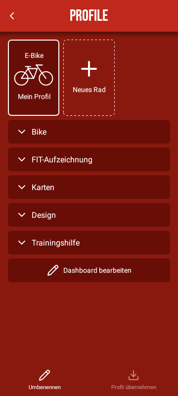

# Fahrradbezogene Profile

Aktueller Stand nach Build 108: [Fahrradprofil-Revision](profile-settings-revision.md). Die dortigen Regeln ersetzen ältere Positionsschalter, Aufklappgestaltung und Farbdialog-Bedienung im folgenden historischen Umsetzungsstand.

Seit der Profil-Integration bündelt **Einstellungen → Profile** die bisherigen Bereiche Bikes, Karten und Design & UI auf einer Seite. Fahrer und Upload-Dienste bleiben global.

- Oben ein bis sechs Fahrradkacheln, drei sichtbar, horizontales Scrollen und gemeinsame Drag-and-drop-Vorschau.
- Eine lange Seite mit einzeln auf-/zuklappbaren Sticky-Abschnitten (zunächst alle offen): **Sensoren**, **FIT-Aufzeichnung**, **Strecken-Aufzeichnung**, **Karten**, **Design & UI**, **Bosch-Fahrmodus**, **Trainingshilfe**. TERTIARY-Hintergrund, FOREGROUND-Linien oben/unten, Schrift FOREGROUND.
- Profilname als reguläres aufklappbares Sticky-Accordion in beiden Designs (Glow: gemeinsame Box). Chevron klappt den Abschnitt, Titel editiert separat direkt im Header; Bild/Platzhalter stets 16:9, Radtyp-Dropdown Bike/E-Bike/Indoor, Kategorie/Radumfang, Sensoren sowie Indoor-Korrektur. Keine Sticky Header Bike oder Radtyp; Sensorschalter in normaler Schaltertypografie.
- FIT-Aufzeichnung enthält Geschwindigkeit/Distanz jeweils mit normalem Titel und Dropdown in einer Zeile. Strecken-Aufzeichnung enthält die zusätzlichen Quell-Accordions. Design enthält kompaktes Theme-Dropdown, benannte Dashboards/Layout-Auswahl und Vollbild. Die drei Dashboard-Aktionen stehen im festen Kontextfooter, sobald Design & UI im Fokus ist. Bosch-Fahrmodus folgt als letzter Punkt in Design & UI, mit Abschnittstrenner und sensorartiger Schalter-/Accordion-Zeile ohne eigenen Sticky Header. „Sichtbar im Dashboard“ mit Oben/Seitlich-Auswahl erscheint erst nach Aufklappen.
- Fester Profilfooter **Umbenennen**, **Profil übernehmen**, **Profil löschen**. Löschen bleibt bestätigt und ist beim letzten Profil ausgeblendet.
- Theme-, Dashboard-Layout- und Fahrmodus-Zwischenheader sowie Fahrmodus-Erklärung entfallen. Nach der Kartenauswahl kein zusätzlicher horizontaler Trenner. FIT-Untergruppen behalten ihre Funktion; Buttons und Dropdowns verwenden SECONDARY, 1-dp-FOREGROUND-Rahmen mit 50 % Deckkraft und 6-dp-Rundung. Sensordetails sind über einen eigenen Chevron neben dem Schalter ausklappbar; beide Aktionen funktionieren unabhängig.
- Profil übernehmen bietet ausschließlich andere Profile an und kopiert Konfiguration einschließlich FIT, Theme/Dashboards/Trainingshilfe und Karten. **Zielname, Ziel-ID, Bild und gekoppelte Sensorgeräte bleiben erhalten.** Die Quelle wird nicht verändert.

## Archivierter Hierarchie-Prototyp – Accordiontest

Benannte Designreferenz mit vollständigen Konventionen und fest verlinkten Vorschauen: [Accordiontest](accordiontest.md).

Im archivierten Stand Build 25 verwenden die fünf Hauptbereiche `ProfileAccordion`: Kategorie-Icon links, 23 sp/Roboto 900 Black, Chevron rechts, TERTIARY-Kopf mit 10-dp-Rundung und geschwungener, 3 dp breiter linker FOREGROUND-Kante. Kopf und Inhalt haben keinen umlaufenden Rahmen. Eine dünne vertikale FOREGROUND-Linie begleitet den geöffneten SECONDARY-Inhalt, links um 4 dp eingerückt, und schließt ohne Lücke an die linke Kurve des nächsten Hauptbereichs an. Lange Überschriften behalten ihre Schriftgröße und dürfen umbrechen.

Unterüberschriften stehen zentriert zwischen horizontalen Linien auf Texthöhe. **Radtyp**, **Sensoren**, **FIT-Hauptquelle** und **Aufzuzeichnende Werte** sind nun ebenfalls Sticky Header. Die bisherigen Design-Unterüberschriften verwenden dieselbe Optik. Jeder Header ist durch `sectionEnd` auf das Ende seines eigenen Accordions begrenzt, auch wenn der folgende Hauptbereich geschlossen bleibt. Innerhalb der FIT-Unteraccordions bleibt die dezente Standarddarstellung erhalten. Andere Screens werden nicht umgestellt.

[Design-Vorschau mit Testdaten](previews/profile-accordions.png) · [FIT-Vorschau mit Testdaten](previews/profile-fit-accordion.png)

## UI-Speicherung und Migration

`BikeUiConfigurationStore` speichert pro stabiler Bike-ID einen typisierten UI-/Karten-Snapshot unter `bikeUiProfilesV1`. Die aktiven bestehenden Preferences bleiben die gemeinsame Schnittstelle für alle bisherigen Komponenten. Vor einem Profilwechsel wird der aktuelle Stand gesichert; beim Wechsel werden die verwalteten Schlüssel vollständig ersetzt. Nicht vorhandene Schlüssel bleiben auch nach einem Rückwechsel abwesend und übernehmen keine Werte des zuvor gewählten Profils. Der aktive Stand liegt weiterhin sofort in den bestehenden Preferences und übersteht einen Prozessneustart.

Bei der ersten Migration erhalten alle vorhandenen Fahrräder dieselben bisherigen gemeinsamen Einstellungen. Neue Fahrräder beginnen mit einer Kopie der aktuellen UI-/Karteneinstellungen und ihrer bisherigen neuen Bike-Standardkonfiguration. Beim Löschen wird nur der entsprechende Snapshot entfernt. ThemeManager, Dashboard und Karte laden nach einem Wechsel neu; Fahrrad-/Trainerverbindungen und Fahrtwerte werden über den Runtime-Wechsel getrennt/zurückgesetzt. Ein bestätigter Live-Pulsmesser kann nach der unten dokumentierten Wiederverwendungsregel verbunden bleiben.

Auch gewählte Karte, Nachtansicht, Ausrichtung, Ovalmodus, Zoom/Kameraposition, Höhenkorrektur und die ausgewählte FIT-/GPX-Kartenstrecke sind profilbezogen. Dateizugriffe bleiben auf dem bestehenden Kartenworker. Fehlende/gelöschte Streckendateien erzeugen keine erfundenen Routen.

**Global bleiben** Fahrerprofil, Benachrichtigungen, Streckenarchiv, Upload-Konfiguration/-Zugangsdaten und Kartenanbieter-Schlüssel. Die selektive Einstellungssicherung enthält im Bereich Profil inzwischen alle aktiven/inaktiven Profile samt bestätigten Gerätezuordnungen, portablen UUIDs und UI-Snapshots; neue verschlüsselte ZIPs zusätzlich die Bilder. Siehe docs/settings-archive.md. Konten und Gerätezuordnungen gehören nicht in die UI-Snapshots.

Profilwechsel, Übernahme, Hinzufügen, Löschen und Umsortieren bleiben während Aufnahme/Speichern gesperrt. Nach einem Rebuild dürfen ausstehende Spinner-Callbacks keine alte Konfiguration zurückschreiben.

## Frühere Sensor-/Bike-Architektur und technische Details

# Bikes – dynamische Profilverwaltung

Die bisherige Sensorenseite heißt **Bikes** und verwendet das vorhandene Bike-Icon.
Bis zu sechs Profilkacheln stehen in einer horizontal scrollbaren Auswahl; drei
gleich breite Kacheln passen nebeneinander. „Neues Rad“ mit Plus steht am Ende,
bis sechs Räder angelegt sind. Darunter stehen der
antippbare Name (direkte Eingabe, gültige Änderungen sofort speichern), Radtyp,
Fahrradkategorie als Dropdown, Radumfang, Sensorverwaltung und FIT-Auswahl.
Ein gemeinsamer Fullscreen-Header, keine zusätzliche Footer-Navigation.

## Profile und Migration

- Ein bis sechs lokale Profile; Namen, Kategorie, Radumfang, Start-Verbindungsoption,
  Sensorzuordnungen, Kategorie-Schalter und FIT-Konfiguration pro Profil.
- Bike 1 übernimmt die bisherigen Bosch-/Pulsmesser-Zuordnungen, GPS-Einstellung
  und FIT-Feldauswahl/-Hauptquellen. Die anderen Slots übernehmen keine Zuordnung.
- Die aktive Auswahl bleibt über App-Neustarts erhalten. Wechsel bei Aufnahme oder
  Speichervorgang gesperrt. Alte GATT-Verbindungen werden beendet; veraltete
  Callback-Generationen bleiben durch die bestehenden Verbindungsclients gesperrt.
- Dashboard-Belegungen bleiben gemeinsam. Keine neuen FIT-Felddefinitionen oder
  Reskalierung bereits fertiger Bosch-Geschwindigkeits-/Distanzdaten.
- Radumfang 500–4000 mm als Profilwert, noch kein zusätzlicher Radsensor-Decoder.
  Ungültige Eingaben überschreiben nicht den zuletzt gültigen Wert.
- Einstellungssicherung: aktive FIT-Auswahl plus alle Fahrradprofile samt Sensorzuordnung und UI-/Karten-Snapshots im Profilbereich; seit Stand nach Build 70 Bilder und Dienstzugänge im passwortgeschützten ZIP. Kein unkontrolliertes Serialisieren vollständiger Preferences. Details docs/settings-archive.md.

`BikeProfileStore` hält die Profile mit stabiler Kennung versioniert und spiegelt nur das aktive
Profil in die bisherigen Runtime-/Backup-Schlüssel. Bestehende Restore-Aufrufe auf
aktive FIT-Schlüssel bleiben dadurch wirksam. Unveränderte Profil-JSON-Daten werden
nicht bei jedem Sensortick erneut dekodiert; Kachelbilder werden nur bei Änderungen
neu aufgebaut. Keine zweite Sensorverarbeitung oder parallele Aufzeichnung.

## Hinzufügen, Löschen und Reihenfolge

- Frische Installation: ein Rad mit migrierten aktiven Einstellungen. Vorhandene
  vier V1-Profile bleiben vollständig erhalten, inklusive Namen und Fotos.
- Die bisherige `slot`-Kennung wird zur stabilen, monoton vergebenen ID; die
  JSON-Reihenfolge ist unabhängig davon. Alte JSON-Zeilen ohne `slot` erhalten
  ihren früheren Index. IDs werden beim Löschen nicht wiederverwendet.
- Langes Drücken startet Android-Drag-and-drop. Ablegen verschiebt das Rad an die
  Zielposition; am sichtbaren Rand scrollt die Reihe während des Ziehens weiter.
  Der gemeinsame `TileReorder` (auch Dashboard-Seiten in Design & UI) zeigt eine
  halbtransparente Vorschaukachel mit ACCENT-Kontur am Ziel und lässt Nachbarn in
  180 ms zur Seite rücken. Beim Ablegen federt die Kachel durch eine kurze
  Größenanimation ein. Hover verändert keine gespeicherten Daten; Abbruch setzt
  die Vorschau zurück. Plus-Kacheln und die kompakte Schnellauswahl bleiben ausgenommen.
  TalkBack bietet zusätzlich „Nach links/rechts verschieben“ an.
  Die Einrastanimation startet erst nach `DRAG_ENDED`, damit dessen Bereinigung
  sie nicht halbwegs abbrechen kann. Abbruch, erneutes Ziehen und Entfernen der
  Ansicht verwerfen ausstehende Animationen und setzen beide Skalierungen auf 1.
- Auswahl bleibt beim Verschieben erhalten. Sensor-/FIT-Konfiguration und Fotos
  hängen an der Profil-ID, nicht an der sichtbaren Position.
- Gemeinsamer fachlicher Footer mit „Rad löschen“ und Bestätigung für das aktuell
  ausgewählte Rad. Bei nur einem Rad vollständig GONE, kein Platzbedarf.
  Veraltete Bestätigungen dürfen kein inzwischen anderes Rad löschen.
- Löschen wählt ein benachbartes Rad, beendet alte Verbindungen und entfernt nur
  das Profil und sein privates Foto. Bereits aufgezeichnete Fahrten bleiben erhalten.
- Während Aufnahme/Speichern sind Hinzufügen, Löschen, Verschieben und Profilwechsel
  gesperrt. Die Obergrenze und das letzte verbleibende Rad sind zusätzlich im Store
  geschützt. Das bestehende manuelle Backup bleibt unverändert (keine Profilfotos
  oder Sensorzuordnungen exportieren).

## Typen und Bilder

Bike, E-Bike und Indoor-Bike sind im Modell vorhanden; **E-Bike und Indoor-Bike sind aktiv**. Normales Bike bleibt deaktiviert.
Die Trainerrolle für Indoor ist aktiv; zusätzliche Powermeter-Rollen bleiben
vorbereitet. Indoor verwendet ausschließlich Trainer und optionalen
Pulsmesser, keine GPS-, Bosch- oder separate Powermeter-Rolle. Tempo, Distanz,
Kadenz und Fahrerleistung kommen vom Trainer, soweit tatsächlich verfügbar.
Die BLE-/FTMS-Anbindung ist ab 0.7.25 umgesetzt gemäß
[Matrix-ICR50-Briefing](ble-trainer-matrix-icr50.md); jetzt keine Trainerbefehle senden.

Mountainbike, Rennrad, Trekkingbike, Gravelbike und Citybike sind als Kategorien
wählbar. `BikePreview` zeichnet leichte kategorienspezifische Platzhalter;
endgültige Bilder folgen nach Sichtprüfung. Keine neue Iconbibliothek.

## Sensorverwaltung

- Zentral **Sensor suchen / verbinden**, keine getrennte Gerätesuche pro Zeile.
- Kategorien GPS, E-Bike, Powermeter und Pulsmesser; Powermeter vorerst deaktiviert.
- Kategorie-Schalter, gespeicherter Name, Status, verfügbarer Akku und Disconnect.
  GPS hat keinen Gerätesensorakku. Nicht verfügbare Akkudaten erscheinen als „–“.
- Ausschalten oder Disconnect behalten Zuordnungen. „Zuordnung entfernen“ entfernt
  gezielt nur die gespeicherte Verbindung dieser Kategorie.
- Disconnect blockiert Wiederverbindung für die aktuelle App-Sitzung; die zentrale
  Verbindungsaktion oder erneutes bewusstes Einschalten hebt die Blockade auf.
- Automatik bezieht sich auf den Start des ausgewählten Profils/App-Prozesses;
  Ausschalten dieser Startoption trennt keine bereits laufende Verbindung.
- Bereits zugeordnete Geräte erscheinen nicht erneut als neue Treffer.
- Suche maximal zehn Sekunden. Bekannte/gekoppelte Geräte bleiben auffindbar.
  Anzeigen nur nach passender Service-UUID im Advertisement oder nach bestätigter
  Diensterkennung einer kurzen, seriellen GATT-Prüfverbindung (maximal drei Sekunden
  pro Kandidat, begrenzte Warteschlange). Namen werden nicht zur Typerkennung benutzt.
- In dieser Phase unterstützt die Suche Bosch MCSP und standardisierte Pulsmesser.
  Probeverbindungen abonnieren keine Messdaten und werden wieder geschlossen.
- Profilwechsel, Schließen und App-Hintergrund stoppen die Suche samt Probe.
- GPS-Aus wird beim Aufnahmestart respektiert. Neue Outdoor-Profile starten mit
  aktiviertem GPS; eine vorhandene explizite GPS-Aus-Einstellung wird migriert.

## FIT

Deutlich benannte **FIT-Hauptquelle** für Geschwindigkeit und Distanz samt kurzer
Erklärung: Hauptquelle = Standardwert für andere Programme; zusätzliche angehakte
Quellen = getrennte Developer Fields. Bestehende Auswahl einschließlich optionaler
Performancewerte bleibt pro Bike erhalten. Ausschließlich reale vorhandene Quellen
anbieten; kein fiktiver Powermeterwert. Abgelöste Formularinstanzen dürfen keine
Einstellungen in ein inzwischen anderes Profil schreiben.

## Vorschau

Echte native Android-Testdarstellung mit Beispieldaten, keine Bildmontage:

- [Profilbereich](previews/bikes-top.png)
- [Sensorbereich](previews/bikes-sensors.png)
- [FIT-Bereich](previews/bikes-fit.png)

## Verifikation

Vollständige Suite: **403 Tests bestanden**, keine Fehler oder übersprungenen
Tests. Nach abschließenden UI-Anpassungen zusätzlich 18 gezielte Prüfungen für
Migration/Profilpersistenz, Runtime-/Aufnahmesperre, BLE-Suche auf API 33/35/36,
Native-UI, Themewechsel und FIT-Auswahl; danach erneut vier UI-/Themeprüfungen.
Debug- und Release-Kotlin-Kompilierung erfolgreich. Nach der abschließenden Transparenzänderung
die beiden Streckenmanager-Tests und Release-Kotlin-Kompilierung erneut erfolgreich.

Die BLE-Prüfungen verwenden Android-Testdoubles; physische Mehrgeräteverbindungen
sind noch am Telefon zu testen. Keine neue APK erzeugt oder veröffentlicht.

## FIT-Abschnitt und aktive Controls

Die FIT-Aufzeichnung steht als fester Sticky-Abschnitt unter den Sensoren. Hauptquellen sind direkt sichtbar; zusätzliche FIT-Felder werden pro Datenquelle in einem zunächst geschlossenen Accordion angeboten. Deren Offen-Zustand bleibt bei Bikewechsel innerhalb derselben Activity erhalten. Werte und Sofortspeicherung pro Bike bleiben erhalten. Auswahlkreise und Schalter verwenden bei Aktivierung zentral ACCENT; Kreis-Kontur und Beschriftung bleiben FOREGROUND, deaktivierte Controls gedimmt.

## Radumfang: einzeilige Eingabe

Im Bike-Dialog stehen Beschriftung, Eingabewert und mm in einer Zeile.
Der Wert verwendet Bebas Neue und den gemeinsamen Wert `analysisMetricSp`
(28 sp), wie die Zonenwerte im Fahrerprofil. Transparenter Eingabehintergrund,
rechte Ausrichtung und 1 physischer Pixel TERTIARY als Rahmen. Eingabevalidierung
(500–4000 mm) und automatische Speicherung bleiben erhalten. Dasselbe gemeinsame Zahlenlayout wird auch für die fünf numerischen Eingaben
im Fahrerprofil verwendet. WebDAV-Felder erhalten den Rahmen mit Systemschrift.

[Native Vorschau](previews/bikes-wheel-row.png). Gezielt geprüft über
BikesViewTest und die Release-Kotlin-Kompilierung; keine neue APK gebaut.

## Verifikation der dynamischen Profile

37 gezielte Tests über Profilstore, Migration alter vier Profile, Sechs-Räder-Limit,
Nicht-Wiederverwendung gelöschter Kennungen, Auswahl/FIT, native Drei-Kachel-Breite
auf zwei Hochformatbreiten, horizontales Scrollen, Drag-and-drop-Ereignisse,
Accessibility-Verschieben, Löschbestätigung, letzte verbleibende Kachel und
Aufnahmesperren. Fotos bleiben bei Umsortierung zugeordnet und werden nur mit dem
gelöschten Profil entfernt; Fahrtdateien bleiben erhalten. Zusätzlich Wetter,
kompakte Detailtrenner, Header-Abstände und bisherige Streckeninteraktionen geprüft.
Release-Kotlin-Kompilierung erfolgreich. Nach der abschließenden Transparenzänderung
die beiden Streckenmanager-Tests und Release-Kotlin-Kompilierung erneut erfolgreich. Keine neue APK in diesem Änderungsschritt.
Die reale Android-Drag-Geste samt Randscrollverhalten sollte am Gerät optisch geprüft
werden; automatisiert sind Ereignisverarbeitung und gespeicherte Reihenfolge geprüft.

Aktive Indoor-Integration, FIT und reale Prüfgrenzen: [Indoor/FTMS](indoor-ftms.md).

## Schutz beim Wechsel des Radtyps

Der Indoor-Feldfilter ist eine Laufzeitsicht. Indoor-Speichern ersetzt nur die dort verfügbaren Felder; ausgeblendete GPS-/E-Bike-Felder und die zuvor gewählten Outdoor-Hauptquellen bleiben gespeichert und erscheinen nach Rückkehr wieder. Bewusste Änderungen sichtbarer gemeinsamer Werte werden weiterhin gespeichert. GPS-Positionsaufzeichnung ist bei Bike/E-Bike an den GPS-Sensorschalter gekoppelt, ohne zweite FIT-Checkbox. Die alte GPS_POSITION-ID bleibt zur Dateiformat-/Backup-Kompatibilität erhalten; Outdoor-Journals reservieren Positionsspalten und schreiben nur bei aktiviertem GPS tatsächliche Koordinaten, auch wenn GPS erst während der Fahrt aktiviert wird. Indoor bleibt ohne Positionen.

## Aufzeichnungsabschnitte auf der Hauptebene

FIT-Aufzeichnung und Strecken-Aufzeichnung stehen nun wie Sensoren, Karten und Design & UI direkt auf der Hauptebene. Beide Header nutzen die volle Seitenbreite und besitzen eine eigene auf-/zuklappbare Inhaltsgruppe. Der 32-dp-Abstand nach der Sensorliste bleibt erhalten. Hauptquellen und Feldgruppen teilen weiterhin dieselbe vorhandene Konfiguration und sofortige Speicherung; keine neue Aufzeichnungslogik.

## Vollbild zuerst in Design & UI

Umgesetzt am 17.10.2026 nach Build 30: **Dashboard im Vollbild** steht als erster Inhaltspunkt in **Design & UI**, vor Theme- und Dashboard-Auswahl. Gilt auch im eingebetteten Profilabschnitt.

## Weitere Darstellungsänderungen nach Build 30

- Mülltonne über dem Fahrradbild mit transparentem Hintergrund, ohne zusätzliche Formularfläche oder Kontur; Touchfläche und Löschen bleiben erhalten.
- Vergrößern-Symbol über der Karte in den Streckendetails fest schwarz, auch nach Themewechsel.
- Historischer Stand Build 31, mittlerweile durch das neue 14-Paletten-System ersetzt: Theme **Embers Inv.**: PRIMARY `#BF281B`, SECONDARY `#1D1D1D`, TERTIARY `#000000`, FOREGROUND `#FFFFFF`, ACCENT `#BF281B`. SECONDARY/TERTIARY von Embers getauscht, das bisherige Grau `#292929` um ca. 30 % abgedunkelt. Ursprüngliches Embers bleibt erhalten. Die bestehende Profil-/Theme-Sicherung verwendet die neue stabile ID `preset:embers-inv`. Der vorhandene Lesbarkeitsfallback für Accent-Icons bleibt bestehen; nur für dieses zusätzliche Preset ist der geringe Accent-Kontrast auf SECONDARY zugelassen.

## Helle und dunkle Einstellungen

Die Themeauswahl ist profilbezogen und verwendet die [14 festen Paletten](theme-palettes.md). Hell/Dunkel der Einstellungsansichten ist dagegen global: Sonne/Mond erscheint ausschließlich auf der Einstellungs-Hauptseite. Profilwechsel und Profilübernahme verändern diese Auswahl nicht. Alte profilbezogene Hell/Dunkel-Werte werden ignoriert. Details: [Einstellungsdarstellung](settings-appearance.md).

## UI-Feintuning vom 18.10.2026

- Radtyp-Auswahl: Icon und Text vertikal mittig über native Compound-Drawables, 8 dp Abstand.
- Auswahlfelder/Quell-Accordions: zentrale 14 sp wie Textbuttons; Quellen mit gemeinsamen SensorIcons, Chevron rechts. Runde Auswahlfelder haben 8 dp zusätzlichen Abstand zum Text.
- Bosch-Fahrmodus ist der letzte Inhalt in Design & UI, nach einem horizontalen Abschnittstrenner. Keine eigene Überschrift und kein Sticky Header. Schalter und Chevron sind unabhängig; nur die Zeile „Sichtbar im Dashboard“ mit ihrer bestehenden Oben/Seitlich-Auswahl wird aufgeklappt. Bestehende Speicherung und Profilwechsel-Sperren bleiben erhalten.
- Profil-/Dashboardaktionen nennen das Ziel ausdrücklich. Der feste Footer wechselt beim Scrollen ab Design & UI zu den Dashboardaktionen; oben stehen die Profilaktionen.

Indoor-Unterauswahl (18.10.2026): Direkt unter dem Radtyp-Dropdown erscheint ausschließlich bei Indoor ein zweites Dropdown mit Hometrainer (Standard, aktiv) und Rollentrainer (sichtbar, deaktiviert/gedimmt). Normale Kategorieauswahl bleibt bei Indoor verborgen, bei Outdoor unverändert. Solange nur Hometrainer verfügbar ist, ist keine zusätzliche gespeicherte Auswahl nötig. Sensor-/FTMS-Verarbeitung, FIT und Korrekturfaktoren bleiben unverändert. Während Aufnahme/Speicherung ist auch dieses Dropdown gesperrt.

Kontextfooter (18.10.2026): ProfileContextFooter verwendet die bestehenden Aktionsviews. Wechsel bei ungefähr halber Viewporthöhe des Design-Headers, 24 dp Rückschaltpuffer, 180 ms Überblendung und 8 dp Bewegung. Feste 64 dp Höhe verhindert Layoutsprünge. Während der Überblendung keine Touchaktionen; danach nur aktive Gruppe sichtbar. Profilwechsel/Rebuild bindet die neuen Dashboardaktionen ein. Ein geschlossenes Design und der Seitenanfang zeigen Profilaktionen.

Dashboard-Schnellauswahl nach Build 56: drei Spalten und bei sechs Bikes zwei Reihen. Gemeinsame BikeProfileStrip-Kacheln in voller Profilgröße (154 dp Höhe, unverkleinerte Bilder und Schrift), nur bestehende Bikes ohne Hinzufügen/Sortieren. Profilmanager behält seine horizontale Auswahl.

Pulsmesser beim Profilwechsel: Ein bereits verbundener, bestätigter Pulsmesser bleibt für ein Zielprofil mit aktivierter Pulsfunktion verbunden, wenn dort keiner oder derselbe Sensor zugeordnet ist. Bei bisher leerem Ziel werden Adresse und Name übernommen und gespeichert; kein erneutes Suchen/Koppeln nötig. Eine eigene andere Zuordnung sowie ausgeschaltete Pulsfunktion werden respektiert. Nur Live-Puls/Batterie erhalten, keine Fahrtmittelwerte. Typwechsel und Einstellungswiederherstellung übernehmen keine fremde Sensorzuordnung automatisch.

## Autostart der Aufnahme nach Build 72

Schalter direkt unter Radumfang, horizontaler Trenner darüber. Pro Profil `autoStartRecording`, standardmäßig false; optionales Profil-JSON-Feld, alte Profile/Sicherungen bleiben ausgeschaltet. Profilkopie übernimmt die Option, Profilwechsel/Wiederherstellung erhält sie; Einstellungssicherung umfasst aktive und inaktive Profile mit strikter boolescher Validierung.

Bei geöffneter App startet der bestehende RecordingService mit Foreground-Priorität, sobald das E-Bike LIVE bzw. der FTMS-Trainer subscribed ist. Keine Bewegung oder ersten Trainingswerte abwarten. Ebenso beim Öffnen der App mit bereits bestehender Verbindung; bei bereits eingeschaltetem Rad erfolgt der Start nach der üblichen Verbindungsherstellung. Bestehende automatische Verbindung bleibt eine separate Einstellung: Autostart ersetzt weder Gerätezuordnung noch Bluetooth-Verbindungsaufbau. Wiederholte Status-/Messpakete sowie veraltete Indoor-Messdaten erzeugen keinen neuen Start. Bewusstes Stoppen startet bei derselben Verbindung nicht sofort erneut; neue Verbindung oder erneutes Öffnen kann wieder starten.

Laufende Aufnahme/Speicherung/HRV haben Vorrang, kein wartender Start nach deren Ende. Während verborgener App kein neuer Foreground-Start; laufende Aufnahmen wie bisher im Hintergrund fortsetzen. Auch eine zwischen Verbindungsereignis und Service-Start aktiv gewordene HRV-Messung darf nicht unterbrochen werden; Service räumt dann seine Priorität auf. Kein automatisches Stoppen bei Verbindungsverlust. Keine neue APK.

Prüfstand Autostart: zwölf unterschiedliche gezielte Tests erfolgreich (sechs neue Verbindungs-/Appstart-/HRV-/UI-/Profilbackupfälle, drei bestehende Sicherungsfälle und Aufnahme mit Foreground-Service auf Android 13/15/16). HRV-Service-Grenze nach letzter Absicherung erneut erfolgreich, Typografie-/Atlasprüfung konsistent. Kein Hardwaretest und keine APK.

## Flexible Aufzeichnungsquellen nach Build 72

Hauptquellen für Geschwindigkeit, Distanz, Fahrerleistung, Kadenz, Puls und Höhe anhand eingerichteter Sensoren. Auswahl erst ab zwei Quellen, sonst eindeutige Zuordnung bzw. keine Quelle. Präferenz je Profil/Backup, eingefroren beim Start; automatisch frische Ersatzquelle und Rückkehr zur bevorzugten. Smartphone-Drucksensor mit GPS-Referenz ergänzt. Outdoor-Präferenzen beim Indoor-Typwechsel erhalten. Separate Powermeter bleiben vorbereitet, nicht implementiert. Details [Quellenmodell](recording-source-selection-plan.md).

Stand 23.10.2026: die beschriebenen neuen Änderungen sind in APK **0.8.34 / Build 73** enthalten. [Buildnachweis](build-73.md). Frühere Angaben zu fehlender APK sind Verlauf.

Bildauswahl: Nur der leere Platzhalter öffnet die Dateiauswahl. Ein vorhandenes Bild bleibt beim Antippen unverändert; für einen Austausch zuerst über das Löschsymbol entfernen, dann ein neues Bild wählen. Gilt identisch in Flat und Glow; private Bilder-/Identitäts-/Backup-Pfade unverändert.

Fahrerprofil: Herzfrequenz- und Leistungszonen zeigen Werte samt Einheiten rechtsbündig und in gleicher Schriftgröße (settingsMetricSp, bei Platzmangel gemeinsam verkleinert). Methodenbezeichnungen als zentrale kleine900-Black-Überschriften. Nur Darstellung; Zahlenbereiche, aktuelle Methode und FTP-/Pulsberechnung unverändert. AnalysisValueRow-Defaults für andere Screens nicht geändert.

Fehlende Hauptsensoren: Neue [Sensor-Startkarte](sensor-setup.md) für E-Bike ohne Bikezuordnung und Indoor ohne Trainerzuordnung. Tagespause getrennt je Profil, vorhandene getrennte Geräte nicht als fehlend behandeln. Einstieg nutzt bestehende Suche/Zuweisung.

## Gelöschtes Profil und neu angelegtes gleichnamiges Fahrrad

Fahrten behalten die alte Profil-UUID, Namen/Typ/Farbe als Snapshot; der letzte Radtyp ist zusätzlich pro gelöschter UUID gesichert. Das neue Profil bekommt eine neue UUID. Fahrtnamen und Dreeve-Links hängen nicht von dieser aktiven Profilzuordnung ab und bleiben erhalten. RouteQueryPopup zeigt bisher nur aktuelle Profile, RideProfileColor.slot liefert für die alte UUID null: der aktuelle Fahrradfilter ist daher deaktiviert, Typfilter E-Bike und „Ohne Profilzuordnung“ bleiben verwendbar. Dies verhindert absichtliche falsche Zuordnungen bei wiederverwendeten Slots, ist aber eine fehlende Wiederzuordnungsfunktion im UI. Keine stille Wiederverknüpfung anhand gleicher Namen. Umgesetzt am26.10.2026: [Profil zuordnen](orphan-profile-assignment.md) in Profile plus identischer automatischer Dialog beim Öffnen des Streckenmanagers. Verwaiste gefahrene Fahrten nach alter UUID gruppieren; Name/Typ nur Vorschlag, Auswahl und ausdrückliche Bestätigung des Ziels. Erst danach Metadaten auf bestehendem Bibliotheksworker in einer Transaktion ändern, Originale/Titel/Dienstlinks erhalten. Importierte/unklare Herkunft ausgeschlossen.
